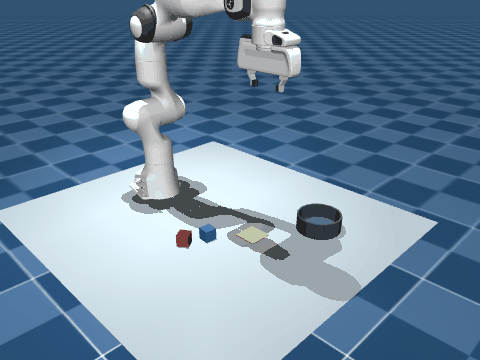
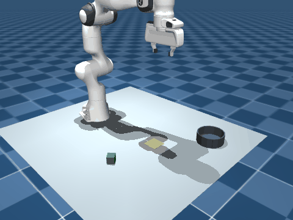
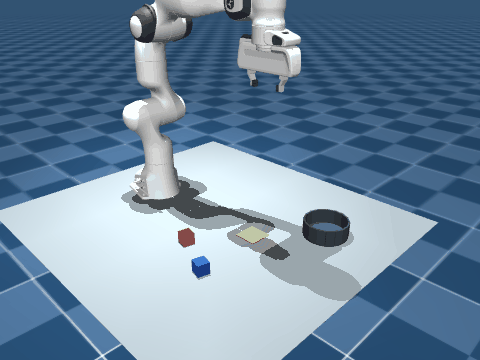

# Blindspot

A simulated Franka Panda environment for evaluating robot foundation models. A MuJoCo scene, scripted and reinforcement-learning experts, and versioned demonstrations support a frozen-backbone VLA baseline, JEPA representations, calibrated latent world models with a generative frame decoder and scenario generation for stress testing, and distilled policies. Methods are compared on shared tasks and seeds, and every model is sized to train on a single laptop (Apple M3 Max). See [the project overview](docs/idea.md) and [the roadmap](docs/roadmap.md).

## Status

| Phase | Scope | Status |
| --- | --- | --- |
| 0–1 | MuJoCo scene, Gymnasium environment, scripted expert, evaluation harness | Implemented |
| 1b | Pure-PPO experts trained from scratch on privileged state | Implemented |
| 2 | Demonstration datasets, world-model interaction corpus, T2-H, shared training infrastructure | Implemented |
| 3 | Frozen-backbone VLA (SmolVLM2-500M plus a chunked action head) | Baseline implemented ([design](docs/vla-baseline.md)); benchmark evaluation pending |
| 4 | In-domain JEPA on T3-L1, probed against frozen DINOv2 | Complete ([design](docs/jepa.md), [results](docs/decisions.md#in-domain-jepa-phase-4)) |
| 5 | Latent world models: uncertainty, physics baselines, planning, policy evaluation, flow-matching frame decoder, scenario generation | Planned |
| 6–7 | Distillation and efficient inference; benchmark and release | Planned |

## Setup

Install `uv` and Python 3.12, then run:

```sh
make setup
make test
make lint
```

The test suite is configured with a `rendering` marker. CI excludes rendering tests because they require a graphics backend; they can be run locally when the required MuJoCo rendering dependencies are available.

## Shared training infrastructure (Phase 2.5)

Install the optional training dependencies and run the tiny infrastructure check:

```sh
uv sync --locked --extra training
make verify-training
```

This is shared run infrastructure, not a replacement for each algorithm's training loop. It lives in `common/training.py`; BC, Stable-Baselines3 PPO, LeRobot, and research models keep their own data pipelines, validation rules, and native checkpoint formats, and connect through thin adapters.

The generic check compares a single-process run with a two-process CPU/Gloo run and verifies exact checkpoint resume. When a trainer starts a `TrainingRun`, it creates its run directory with `run.json` and a `tensorboard/` event directory; the method-specific adapter writes its native checkpoint there. The run record includes config, git commit and dirty-worktree status, seeds, dataset ID/version, hardware, and precision selection/fallback. TensorBoard records scalar training metrics—including losses, gradient norm, learning rate, and throughput—but no parameter histograms or Weights & Biases.

View all training runs under `checkpoints/` with:

```sh
make tensorboard
```

To view only one run, set `TENSORBOARD_LOGDIR` to its `tensorboard/` directory:

```sh
make tensorboard TENSORBOARD_LOGDIR=checkpoints/rl/t2-l1/seed-0-bc-smoke/tensorboard
```

Open the local URL printed by TensorBoard (usually `http://localhost:6006`). Stop the server with Ctrl-C.

## Frozen-backbone VLA baseline (Phase 3.1)

A language-conditioned T3-L policy that reads frozen SmolVLM2-500M image-token
features and trains only a 0.39 M-parameter action head that predicts 0.5 s
action chunks. Architecture, data selection, training, evaluation, and replay
are documented in [docs/vla-baseline.md](docs/vla-baseline.md); design
rationale and ablations are in
[docs/decisions.md](docs/decisions.md#frozen-backbone-vla-baseline).



*Frozen-backbone VLA with 10-step action chunks (limited red/blue profile) on evaluation seed 1,000,011, with the instruction "Place the red cube inside the bowl." and a blue cube on the table. From the camera images, instruction, and robot state alone (no object poses), the policy picks the named cube, carries it to the bowl, and releases it, leaving the blue cube untouched. This is a successful episode from the limited-scope diagnostic evaluation; grasp completion remains the main failure mode (see [Limitations](docs/vla-baseline.md#limitations)).*

## In-domain JEPA (Phase 4)

A LeWorldModel-style JEPA trained from scratch on T3-L1 video and executed
actions: a ViT-Tiny/16 shared by the front (160 px) and wrist (112 px)
cameras, a 256-D latent, and a causal predictor conditioned on 0.2 s action
blocks through AdaLN-zero, trained with next-embedding MSE plus SIGReg (no EMA
target or stop-gradient). It is probed for cube, bowl, TCP, and gripper state
against a random encoder, a supervised encoder of the same architecture, and
frozen DINOv2 ViT-S/14. The design, hypotheses, and measurements are in
[docs/jepa.md](docs/jepa.md).

Install the extra, then collect the two held-out sets (100 validation-seed and
200 evaluation-seed T3 episodes, about 11 min) and decode every dataset once
into the 5 Hz frame cache under `data/cache/frames/` (about 2 min, 7.6 GB):

```sh
uv sync --locked --extra jepa
make jepa-data
```

Each training run takes about 55 min on an M3 Max (6,000 steps at 0.54 s per
step in fp32). To choose λ, start a seed-0 run for each value and stop it
after 1,000 steps (about 10 min each):

```sh
for lambda in 0.05 0.1 0.2; do make train-jepa JEPA_ARGS="--sigreg-weight $lambda --stop-after-steps 1000"; done
```

Compare the validation probe score (`result.history[-1].probe_score` in each
`run.json`, or `validation/probe_score` in TensorBoard; lower is better). Then
resume the winner to 6,000 steps as the final JEPA run (one seed, to fit the
compute budget) and train the supervised ceiling (λ = 0.05 was selected):

```sh
make train-jepa JEPA_ARGS="--resume checkpoints/jepa/t3-l1/lambda-0.05-seed-0"
make train-jepa JEPA_ARGS="--mode supervised"
```

Runs are written to `checkpoints/jepa/t3-l1/` with `run.json`, TensorBoard
scalars (prediction loss, SIGReg, latent effective rank, prediction loss
relative to persistence, AdaLN gate size, and the validation probe score),
and a resumable `checkpoint.pt`. To split a run into shorter sessions, add
`--stop-after-steps N`, then continue with `--resume checkpoints/jepa/t3-l1/<run>`;
the resumed run is identical to an uninterrupted one.

Probe every encoder on the evaluation-seed episodes, roll out each JEPA's
predictor, and render the tables and figures:

```sh
make evaluate-jepa JEPA_EVAL_ARGS="--jepa-runs checkpoints/jepa/t3-l1/lambda-0.05-seed-0 --supervised-run checkpoints/jepa/t3-l1/supervised-seed-0"
make report
```

This writes `eval/results/jepa/T3-L1-probes.json` and `T3-L1-rollout.json`;
`make report` adds the probe table, probe-error chart, rollout error against
horizon, and training diagnostics to `eval/results/report.md`. DINOv2 weights
(`facebook/dinov2-small`, Apache-2.0) are downloaded on first use and the
resolved revision is recorded in the results.

## Evaluation

Run one scripted-expert task and level with 100 episodes by default, using evaluation seeds starting at 1,000,000:

```sh
make evaluate EVALUATE_ARGS="--task T1 --level L1"
```

Useful options include `--episodes`, `--seed-start`, `--workers`, and `--obs-mode state|image`. For example, to run a small smoke evaluation:

```sh
make evaluate EVALUATE_ARGS="--task T1 --level L0 --episodes 2 --workers 2"
```

Run the Phase 1.8 baseline matrix with 100 episodes for T1-T4 across L0-L2:

```sh
make baseline
```

The baseline command prints each cell's success rate, Wilson 95% interval, and failure breakdown. It exits unsuccessfully if an evaluated success threshold is missed. Results are written as JSON under `eval/results/<method>/<task>-<level>.json`; the default expert method directory is `scripted-expert/`.

Generate the Markdown summary and success-rate figure from the saved JSON files:

```sh
make report
```

By default, the report is written to `eval/results/report.md` and `eval/results/success-rates.png`. Use `REPORT_ARGS="--results-dir PATH --output-dir PATH"` to read results from or write reports to other directories. Both `evaluate` and `baseline` accept `--results-dir PATH` through their corresponding `*_ARGS` variable.

## Reinforcement learning (Phase 1b)

Phase 1b trains a pure-PPO policy for each non-language task (T1-T4) from scratch, with no dependency on the scripted expert. Once a task's checkpoint qualifies, it replaces the scripted expert as the demonstrator for the learned models and serves as the privileged teacher for distillation (see [the roadmap](docs/roadmap.md)).

- **Action:** bounded deltas from the controller's TCP target and a binary gripper. A shared command tracker integrates them into the absolute `[x, y, z, yaw, g]` action, so a frozen checkpoint is a drop-in `Policy` like any other.
- **Reward:** staged and non-positive per step (reach → grasp → carry → place → open), plus a success bonus.
- **Curriculum:** by default, 30% of object-task training episodes start with the cube already grasped. `--destination-start-fraction` optionally starts some of those partway along the path to the destination, which long carries such as T3's need.

The [design decisions](docs/decisions.md#rl-environment-specification) explain these choices.


*Pure-PPO T2-L1 policy (seed 0, best validation checkpoint) on evaluation seed 1,000,030: reach, grasp, carry, place, release.*



*Pure-PPO T3-L1 policy (seed 0, best validation checkpoint) on a held-out evaluation seed: the cube is carried 30-50 cm and released into the bowl. Trained with destination-side grasped starts (`--grasped-start-probability 0.5 --destination-start-fraction 0.6`), a reverse curriculum in which some episodes begin with the cube already held on the way to the bowl, so the policy learns to place and release before it can carry that far.*



*Pure-PPO T4-L1 policy (seed 0, best validation checkpoint) on evaluation seed 1,001,000: picks up the red cube, stacks it on the blue cube, and releases.*

Profile the vectorized environment's throughput and render random-policy rollouts to sanity-check the reward stages:

```sh
make benchmark-rl-env
```

Train one `(task, level, seed)` PPO expert (defaults match the roadmap: 8 parallel environments, 10M environment steps, seed 0):

```sh
make train-rl RL_ARGS="--task T1 --level L1"
```

T3's bowl sits 30-50 cm from the cube, so train it with destination-side starts:

```sh
make train-rl RL_ARGS="--task T3 --level L1 --grasped-start-probability 0.5 --destination-start-fraction 0.6"
```

For a quick smoke run instead of a full 10M-step training job, scale the budget down:

```sh
make train-rl RL_ARGS="--task T1 --level L1 --total-timesteps 20000 --eval-freq 5000 --eval-episodes 5"
```

Training prints a validation-seed success rate every `--eval-freq` steps. Every rollout also prints, and appends to `logs/progress.csv`:

- the training success rate;
- a stage funnel (`funnel/reached`, `grasped`, `lifted`, `carried`, `placed`): the fraction of normal-start episodes that reached each stage, which is the quickest way to see which stage limits a run;
- per-term reward sums (`reward/*`) and PPO diagnostics (`train/std`, `train/approx_kl`, `train/explained_variance`).

The final checkpoint, its `VecNormalize` observation statistics, and a `run.json` record (full config, git commit, hardware, and the validation learning curve) are written under `checkpoints/rl/<task>-<level>/seed-<seed>/`. The roadmap calls for 3 training seeds per task; run the command once per `--seed`.

While training runs, the same directory also accumulates resumable intermediate checkpoints: `checkpoints/step_<N>/` every `--checkpoint-freq` steps (defaults to `--eval-freq`; only the last `--keep-last`, default 2, are kept), and a `best/` snapshot that's overwritten whenever the validation success rate improves. Both use the same `model.zip` + `vecnormalize.pkl` layout as the final checkpoint, so either is a valid `--resume-from` target, for example to recover from an interrupted run or to continue from the best validation point.

To extend a run's step budget, pass `--resume-from`. The checkpoint's own hyperparameters (learning rate, network size, and so on) are reused; only `--n-envs`, `--total-timesteps`, `--eval-freq`, `--eval-episodes`, `--checkpoint-freq`, `--keep-last`, `--grasped-start-probability`, `--destination-start-fraction`, and `--device` apply, and `--total-timesteps` counts additional steps. A resumed run writes to a new, auto-versioned output directory and never overwrites its source checkpoint. A reward or observation change requires a fresh run instead, because the value function and normalization statistics depend on both:

```sh
make train-rl RL_ARGS="--task T1 --level L1 --resume-from checkpoints/rl/t1-l1/seed-0 --total-timesteps 5000000"
```

The learning curve in `run.json` is an in-training signal on a small, fixed set of validation seeds. For a reportable result (100 episodes on the evaluation-seed range, with a Wilson 95% interval, through the same harness as the scripted expert and BC), evaluate the checkpoint directly:

```sh
make evaluate-rl RL_EVAL_ARGS="--checkpoint-dir checkpoints/rl/t1-l1/seed-0 --task T1 --level L1 --episodes 100"
```

Results are written as JSON under `eval/results/pure-ppo/<task>-<level>.json`, matching the scripted expert's and BC's result format.

To calibrate the evaluation-only T2-H variant on 200 validation seeds with the frozen T2 checkpoint:

```sh
make evaluate-rl RL_EVAL_ARGS="--checkpoint-dir checkpoints/rl/t2-l1/seed-0/best --task T2-H --level L1 --seed-start 100000 --episodes 200 --results-dir eval/results/t2h-calibration-validation"
```

To watch a checkpoint run in the MuJoCo passive viewer:

```sh
make view-rl RL_VIEW_ARGS="--checkpoint-dir checkpoints/rl/t1-l1/seed-0 --task T1 --level L1 --seed 1000000"
```

Close the viewer after the episode result is printed. Use `--device cpu` (the default) to avoid accelerator overhead for single-episode inference, or `--show-tcp` to display the TCP marker.

To save the episode as a looping GIF instead of opening the viewer, add `--gif PATH`; the episode is rendered offscreen from the viewer's camera angle. `--gif-fps` (default 10, subsampled from the 20 Hz policy rate) and `--gif-width`/`--gif-height` (default 480×360, up to the scene's 512×512 offscreen buffer) control the output. The GIFs above were produced this way from each task's best checkpoint, for example:

```sh
make view-rl RL_VIEW_ARGS="--checkpoint-dir checkpoints/rl/t2-l1/seed-0/best --task T2 --level L1 --seed 1000030 --gif docs/media/t2-l1-pure-ppo.gif"
```

## Demonstrations

Generate 400 successful T2-L1 and T3-L1 demonstrations with the matching frozen PPO checkpoints (380 training episodes and 20 validation episodes per task):

```sh
make demos
```

The generator uses `checkpoints/rl/t2-l1/seed-0/best` and `checkpoints/rl/t3-l1/seed-0/best` by default. Use `DEMO_ARGS="--task T2 --episodes 10 --workers 2"` for a smaller collection, or `--policy-source scripted` to explicitly collect a scripted-expert baseline. New LeRobot datasets use 256×256 RGB, retain both the clean `action` and applied `action.executed`, and store simulator object poses in `observation.environment_state`; `collection.json` records seeds, discard rates, task-label counts, the policy checkpoint path, and its SHA-256 digest. Default names are `t2-l1`, `t3-l1`, and `t3l-l1` (T3-L). Existing datasets are preserved and reruns automatically use versioned names such as `t2-l1-run-02`.

Generate the language-conditioned T3-L dataset using the T3 PPO checkpoint and the training paraphrase set, then generate a separate held-out paraphrase dataset:

```sh
make demos DEMO_ARGS="--task T3-L"
make demos DEMO_ARGS="--task T3-L --instruction-template-split held-out"
```

Each policy step has a 1% chance of receiving a Gaussian perturbation (1 cm xyz, 3 degrees yaw); the clean expert action remains the label, and the applied action is stored separately. The optional open-loop diagnostic requires both noise standard deviations to be zero and `--verify-open-loop`. It records the same-seed clean-action replay rate in `collection.json`; a low rate warns but does not reject the dataset.

## World-model interaction corpus

Collect the 2,000-episode T1-T3 L1 corpus from frozen RL experts, the same experts with large action noise, intermediate PPO checkpoints, and scripted exploration:

```sh
make interaction
```

The collector keeps every episode, including failures, and saves the executed action, the next-state success predicate, simulator object poses, and a source ID for every transition. Scripted exploration targets are checked with Mink IK before they are used. The `interaction-l1/collection.json` manifest records per-source and per-task counts, checkpoint hashes, failures, and workspace/yaw/gripper action-coverage histograms. It also writes `action-coverage.png` with XY, XZ, and YZ occupancy projections plus yaw and gripper histograms. Defaults for the noisy source are 5 cm position noise and 15° yaw noise per step.

Regenerate the coverage plot from an existing manifest without collecting episodes again:

```sh
make interaction-coverage
```

For another corpus or output path, pass `INTERACTION_COVERAGE_ARGS="PATH/collection.json --plot-output PATH/action-coverage.png"`.

Train a behavior-cloning baseline from a generated dataset (MPS is selected automatically when available):

```sh
make train-bc BC_ARGS="--dataset-name t2-l1 --policy state"
make train-bc BC_ARGS="--dataset-name t2-l1 --policy image"
```

Checkpoints and `run.json` records are written under `checkpoints/bc/<dataset>/<policy>/`. Default reruns use numbered directories such as `state-run-02`, preserving earlier checkpoints. An explicit `--output-dir` that already exists remains an error. State BC uses the 12-D proprioception, 28-D oracle object poses, and 4-D target pose. Image BC uses both 128 px cameras with ImageNet-pretrained, frozen ResNet-18 encoders and the 12-D proprioception. The camera embeddings are cached once per train/validation split; only the small fusion/action head is optimized. `train-bc` displays cache, batch, and epoch progress bars in interactive terminals.

The run record includes held-out action MAE by component and frame L1 grouped by demonstration episode. Add `--rollout-validation` to also run the checkpoint in MuJoCo on the collection's held-out validation seeds; the run record stores its success summary and the evaluator writes the per-episode outcomes under the checkpoint directory.

Evaluate a checkpoint on the fixed evaluation seed range and inspect its Wilson 95% interval:

```sh
make evaluate-bc BC_EVAL_ARGS="--checkpoint checkpoints/bc/t2-l1/state/checkpoint.pt --task T2 --level L1 --episodes 100 --workers 1"
```

Evaluation shows a per-episode progress bar. BC evaluation defaults to MPS, then CUDA, then CPU when available; accelerator and image evaluations use one worker by default to avoid duplicating large models. Image BC still takes more compute per step because it renders both cameras and runs both ResNet encoders. Override with `--device` or `--workers` when needed.

Watch one evaluation-seed episode in the passive MuJoCo viewer (`mjpython` is selected automatically on macOS):

```sh
make view-bc BC_VIEW_ARGS="--checkpoint checkpoints/bc/t2-l1/state/checkpoint.pt --task T2 --level L1 --seed 1000002"
```

Close the viewer after the episode result is printed. Use `--device cpu` to reduce accelerator memory use, or `--show-tcp` to display the TCP marker. `view_expert.py` remains the scripted-expert viewer; `view-bc` loads the learned checkpoint.

## Third-party licenses

| Component | License information |
| --- | --- |
| MuJoCo Menagerie | Per-directory terms are retained in the [Menagerie license file](third_party/mujoco_menagerie/LICENSE); check the license for each model used. |
| Franka Emika Panda model | Apache-2.0; see the upstream [Panda license](third_party/mujoco_menagerie/franka_emika_panda/LICENSE). |
| Model weights | No model weights are bundled. Downloaded at run time: [SmolVLM2-500M-Video-Instruct](https://huggingface.co/HuggingFaceTB/SmolVLM2-500M-Video-Instruct) (Apache-2.0) for Phase 3 and [DINOv2 ViT-S/14](https://huggingface.co/facebook/dinov2-small) (Apache-2.0) for Phase 4. |

The [MuJoCo Menagerie submodule](third_party/mujoco_menagerie) is pinned by Git to a specific commit. Dependencies retain their respective upstream licenses. No third-party model weights are redistributed by this repository at this stage.