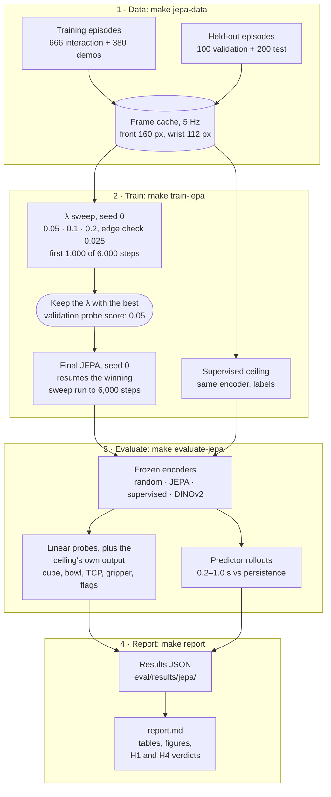
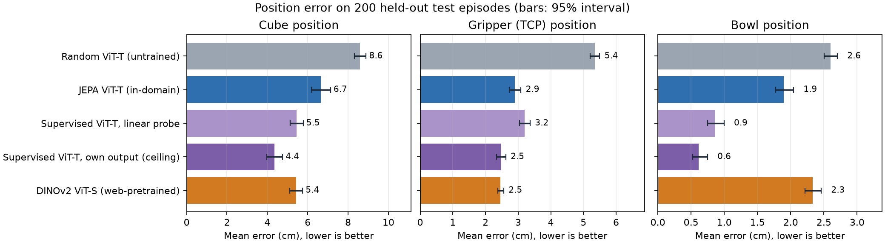
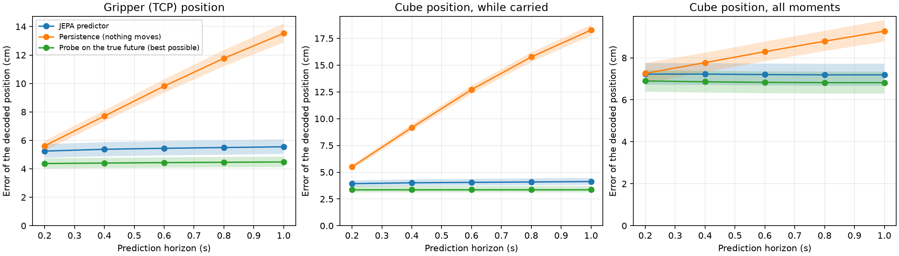
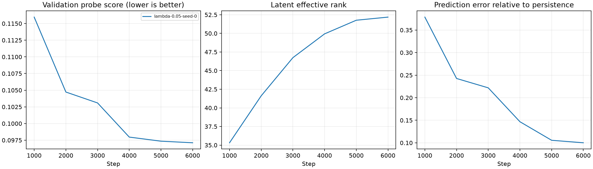
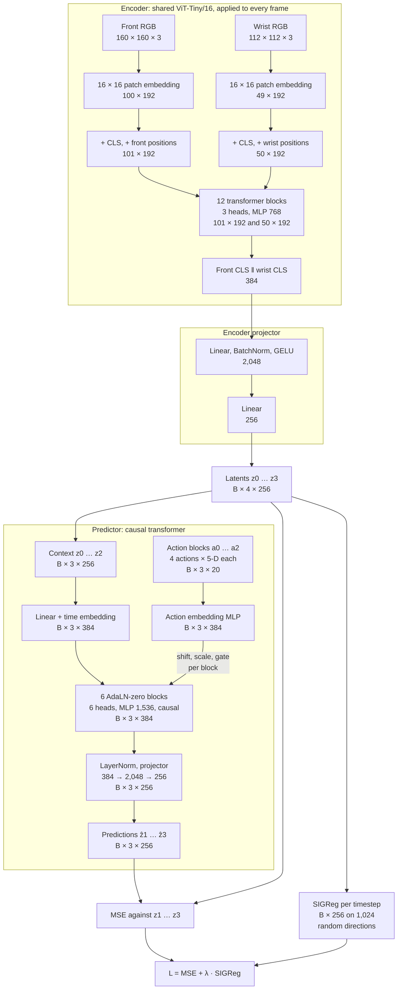

# In-domain JEPA for T3-L1

One experiment: train a small joint-embedding predictive architecture (JEPA)
from scratch on the project's own T3-L1 video and actions, then measure what it
learned. The model follows LeWorldModel (LeWM): a ViT encoder and an
action-conditioned predictor trained end to end from pixels with two loss
terms, next-embedding prediction and SIGReg. No labels, proprioception,
pretrained weights, EMA teacher, or pixel reconstruction are used.

The question is whether a laptop-scale JEPA recovers the task state (arm,
gripper, cube, bowl) from two camera views, and how close it gets to a
supervised encoder of the same size and to a frozen web-pretrained encoder
(DINOv2).

**Status:** complete (milestones M0–M6). H1 and H4 pass, H2 is partly
supported, and DINOv2 is the stronger encoder (H3). See [Results](#results);
`make report` regenerates every number and figure.

## Summary

| Component | Specification |
| --- | --- |
| Question | Does a JEPA trained only on in-domain pixels and actions encode the T3 task state, and does its predictor model the dynamics? |
| Task data | T3 (cube into bowl) at L1: 1,046 training-seed episodes (interaction corpus T3 slice and `t3-l1` demonstrations) |
| Inputs | Front RGB at 160 × 160 and wrist RGB at 112 × 112, at 5 Hz; executed actions between frames. No proprioception, labels, or language |
| Encoder | ViT-Tiny/16 trained from scratch, shared by both cameras, plus a BatchNorm projector to a 256-D latent $z_t$ |
| Predictor | 6-block causal transformer over a 3-step latent history, conditioned on action blocks through AdaLN-zero |
| Objective | $\mathcal{L} = \text{MSE}(\hat z_{t+1}, z_{t+1}) + \lambda\,\text{SIGReg}(z)$; gradients through every term, no stop-gradient or EMA |
| References | Random-init encoder of the same architecture (floor), supervised encoder of the same architecture (ceiling), frozen DINOv2 ViT-S/14 (pretrained generalist) |
| Primary metric | Linear-probe error for cube, bowl, TCP, and gripper state on evaluation-seed episodes, with episode-bootstrap 95% CIs |
| Secondary metric | Predictor rollout error vs horizon (0.2–1.0 s) against a persistence baseline |
| Compute | About 50 min per 6,000-step JEPA run on an M3 Max laptop (see [Compute and storage](#compute-and-storage)) |

## Workflow

The experiment runs in four stages, each with one `make` target. Arrows show
which outputs feed the next stage.

| Stage | Command | Time on the M3 Max | Output |
| --- | --- | --- | --- |
| 1. Data | `make jepa-data` | about 13 min (held-out collection 11 min, decoding 2 min) | `data/datasets/t3-l1-probe-{val,test}/`, `data/cache/frames/` |
| 2. Train | `make train-jepa JEPA_ARGS="..."`, once per run | λ sweep about 9 min per value; finishing the winner about 42 min; supervised ceiling 15 min | `checkpoints/jepa/t3-l1/<run>/` with `run.json`, TensorBoard scalars, `checkpoint.pt` |
| 3. Evaluate | `make evaluate-jepa JEPA_EVAL_ARGS="..."` | about 18 min | `eval/results/jepa/*.json` |
| 4. Report | `make report` | seconds | `eval/results/report.md` and figures |

The exact arguments for each run are in the README.

## Results

### How the evaluation works

1. **Freeze each encoder.** Four encoders are compared, and none is trained
   during evaluation: an untrained, randomly initialized ViT-Tiny/16 (the
   floor); the JEPA; the same ViT-Tiny trained directly on the answers (the
   supervised ceiling); and DINOv2 ViT-S/14, pretrained on web images.
2. **Turn every frame into features.** Each 5 Hz moment of every training,
   validation, and test episode (50,428, 5,765, and 11,528 moments), both
   cameras, is passed through the encoder. Its *global readout* is kept: each
   camera's summary (CLS) token and its average patch token.
3. **Read the true state from the simulator.** The logged cube, bowl, and
   gripper (TCP) positions are the answers. The encoders never see them.
4. **Fit a linear probe.** A ridge regression, fit on the training moments,
   maps the features to each answer. Because it is only a linear formula, it
   can recover a quantity only if the encoder already lays it out clearly. The
   supervised model is also read through its own trained output, its true
   best; that reading is the ceiling.
5. **Score on the 200 test episodes.** The error is the distance in cm between
   the predicted and true position, averaged over every test moment, with a
   95% interval from resampling the test episodes. These evaluation-seed
   episodes are used for nothing else.

The predictor is tested separately. From 3 real moments it predicts 1 to 5
steps (0.2–1.0 s) ahead, using the robot's recorded actions, and the same
linear probe reads positions out of its predictions. It is compared with
*persistence* (assume nothing moves) and with the *probe floor* (the same probe
applied to the true future frame, the best any prediction could do).

The full protocol is in [Evaluation](#evaluation).

### Probe results

*Mean position error on the test episodes; lower is better, and the black
bars are 95% intervals. Every row is a linear probe on a frozen encoder,
except the dark purple ceiling, which is the supervised model's own trained
output. The JEPA locates the cube 1.9 cm better than the untrained copy of
itself and the gripper 2.5 cm better; the ceiling is better than every probe.*

| Encoder | Parameters | Cube (cm) | Cube at rest (cm) | Cube carried (cm) | Bowl (cm) | Gripper TCP (cm) | Gripper width (mm) |
| --- | ---: | --- | ---: | ---: | ---: | --- | ---: |
| Random ViT-T/16 (floor) | 5.5M | 8.6 [8.3, 8.9] | 8.9 | 5.5 | 2.6 | 5.4 [5.2, 5.5] | 4.0 |
| **JEPA ViT-T/16** | 6.8M | **6.7 [6.2, 7.1]** | 6.9 | 3.7 | 1.9 | **2.9 [2.7, 3.1]** | 2.7 |
| Supervised ViT-T/16, linear probe | 6.8M | 5.5 [5.1, 5.8] | 5.6 | 4.1 | 0.9 | 3.2 [3.0, 3.4] | 2.7 |
| Supervised ViT-T/16, own output (ceiling) | 6.8M | 4.4 [4.0, 4.8] | 4.5 | 2.0 | 0.6 | 2.5 [2.3, 2.6] | 2.2 |
| DINOv2 ViT-S/14 (pretrained) | 22.1M | 5.4 [5.1, 5.7] | 5.5 | 3.8 | 2.3 | 2.5 [2.4, 2.6] | 3.7 |

Parameters count the probed network: the ViT encoder, plus the projector for
the JEPA and the projector and head for the supervised model. A linear probe
on the supervised model's features (5.5 cm for the cube) understates what it
learned (4.4 cm through its own output), because its output passes through
the projector, a small nonlinear network, on top of those features. Comparing
the JEPA's TCP probe (2.9 cm) with the supervised probe (3.2 cm) would
therefore suggest the JEPA beats the ceiling; against the ceiling's own output
(2.5 cm) it does not.

Two additional readouts show where information is stored. Keeping a coarse
4 × 4 grid of patch features per camera, instead of averaging them, lowers the
JEPA's cube error from 6.7 to 5.4 cm and DINOv2's from 5.4 to 2.9 cm. A small
MLP probe on the JEPA's global readout reaches 5.6 cm, so part of the JEPA's
information is present but not linearly readable. The complete table, with
every readout and the flag accuracies, is generated by `make report`.

### Predictor rollouts

*Decoded position error as the predictor looks further ahead (shaded: 95%
intervals). If nothing moved, persistence would be exact; it grows instead,
because the gripper and a carried cube move. The JEPA's predictions stay close
to the best possible error at every horizon.*

| Horizon | Gripper TCP: predictor / persistence / floor (cm) | Carried cube: predictor / persistence / floor (cm) |
| --- | --- | --- |
| 0.2 s | 5.2 / 5.6 / 4.4 | 3.9 / 5.5 / 3.4 |
| 0.6 s | 5.4 / 9.8 / 4.4 | 4.1 / 12.7 / 3.4 |
| 1.0 s | 5.6 / 13.5 / 4.5 | 4.1 / 18.3 / 3.4 |

In the latent space itself, the predictor's error is 14% of persistence's at
0.2 s and 6.5% at 1.0 s. A cube resting on the table does not move, so
persistence is already near the floor there, and the predictor matches but
does not improve on it (right panel).

### Training diagnostics

*Over the 6,000-step run (50 min), the validation probe score fell (left), the
latent spread over more dimensions instead of collapsing (effective rank 35 →
52, middle), and next-step prediction error fell from 38% to 10% of
persistence's (right). Most of the gain came by step 4,000.*

### Answers to the hypotheses

| Hypothesis | Verdict | Evidence |
| --- | --- | --- |
| **H1**, learning signal | Supported (pass) | Cube error 6.7 [6.2, 7.1] cm against 8.6 [8.3, 8.9] cm for the random encoder; the intervals do not overlap. |
| **H2**, what it learns | Partly supported | The JEPA closes more of the gap between the random floor and the ceiling for the robot's own state than for objects (table below). A carried cube is located far better than a resting one (3.7 vs 6.9 cm), but relative to the ceiling the two close a similar share of the gap. |
| **H3**, specialist vs generalist | DINOv2 is stronger | The 3× larger, web-pretrained DINOv2 is better on the cube (5.4 vs 6.7 cm) and TCP (2.5 vs 2.9 cm); the JEPA is better on the bowl (1.9 vs 2.3 cm) and gripper width (2.7 vs 3.7 mm). DINOv2 is therefore the encoder for the Phase 6 T3-L1 student (validation probe score 0.067 vs 0.089). |
| **H4**, dynamics | Supported (pass) | At 0.4–1.0 s the predictor beats persistence for the TCP and the carried cube by a wide margin and stays within about 1 cm of the floor. |

How much of the gap between the random encoder and the supervised ceiling
(its own output) the JEPA closes, per target:

| Target | Random (floor) | JEPA | Ceiling | Gap closed |
| --- | ---: | ---: | ---: | ---: |
| Gripper (TCP) position | 5.4 cm | 2.9 cm | 2.5 cm | 86% |
| Gripper width | 4.0 mm | 2.7 mm | 2.2 mm | 72% |
| Cube, carried | 5.5 cm | 3.7 cm | 2.0 cm | 51% |
| Cube, at rest | 8.9 cm | 6.9 cm | 4.5 cm | 45% |
| Bowl | 2.6 cm | 1.9 cm | 0.6 cm | 35% |

Learning by predicting the next moment captures the robot's own state best:
the gripper moves in every frame and its commanded targets are the
predictor's action input. Objects that only move when touched, and the bowl,
which never moves, are learned less well.

### Limitations

- **One training seed.** The intervals cover variation across test episodes,
  not between training runs.
- **In-distribution only.** All episodes are T3 at randomization level L1;
  robustness to lighting and texture changes (L2) is untested.
- **Uninformative targets.** Cube yaw is near chance for every ViT-Tiny
  encoder (about 19°, against 22.5° for guessing), and the held and in-bowl
  flags are near-perfect for every encoder, including the random one.
- **Soft ceiling.** The supervised model was still improving at 6,000 steps,
  so the true ceiling is probably somewhat lower than shown.

## Scope

In scope: one JEPA, three reference encoders, a probe study, and a predictor
rollout study, all on T3 at L1.

Out of scope: closed-loop policies on JEPA features, latent planning, V-JEPA 2
and ResNet-18 probes, L2 robustness, and data-scaling curves. These are listed
as [follow-ups](#follow-ups).

**Why T3-L1.** It has object interaction (grasp, carry, place), two objects of
different shapes, a randomized cube color, and occlusion once the cube is in
the bowl, so "where is the cube" is a non-trivial probe target. Its training
data already existed, so no new RL training was needed; only two small
held-out sets were collected.

## Background

A JEPA has an encoder that maps observations to embeddings and a predictor
that predicts the embedding of a target observation from a context. The loss
lives in embedding space, so the model is not forced to model every pixel; in
exchange, it needs a mechanism that stops the encoder from collapsing to a
constant.

| Variant | What is predicted | Collapse prevention | Fit for this experiment |
| --- | --- | --- | --- |
| I-JEPA (2023) | Masked image blocks from a context block | EMA target encoder, stop-gradient | Single images only; ignores the actions and time structure that define this data. With fixed cameras and a static background, most masked blocks are trivially predictable. |
| LeJEPA (2025) | The mean embedding of an image's global crops, from the embeddings of all its global and local crops | SIGReg: embeddings pushed toward an isotropic Gaussian; one hyperparameter, no EMA or stop-gradient | The regularizer is adopted here. Its crop-invariance objective would discard the absolute positions control depends on. |
| V-JEPA 2 / 2-AC (2025) | Masked video tubes; 2-AC adds an action-conditioned predictor on a frozen encoder | EMA | Pretrained at internet scale (300M–1B parameters); 2-AC encodes each frame independently. Too large to train here. |
| V-JEPA 2.1 (2026) | Dense masked prediction over visible and masked tokens, at several encoder depths | EMA | Better dense features (ViT-B 80M to ViT-G 2B, 384 px), distributed through torch hub. A pretrained reference, not something to train from scratch here. |
| **LeWM (2026)** | **Next-frame embedding from the latent history and actions** | **SIGReg, no EMA or stop-gradient** | **Chosen.** |

**Why LeWM.** It trains end to end from pixels with two loss terms and one
effective hyperparameter ($\lambda$). Its reference model has about 15M
parameters and trains in a few hours on one GPU. It uses exactly what the
interaction corpus provides: trajectories of images and executed actions,
including failures and exploration. Its encoder is a per-frame image encoder
that can be probed like any other, and its predictor is already a latent world
model, so the result feeds Phase 5 directly. On OGBench-Cube, a single-cube
pick-and-place task, its probes recovered block and end-effector position
best among the compared models, while block orientation was hard for every
model.

**Known risks from recent work**, which shape the evaluation:

- LeWM was weaker in a low-diversity environment, where matching a
  high-dimensional Gaussian is hard. Fixed cameras and a few moving objects
  make this scene low-diversity too.
- JEPA world models can preserve static, episode-specific content while
  suppressing the manipulated object ("static collapse",
  arXiv:2611.06901). The probe therefore reports cube error separately for a
  resting and a held cube.
- One-step prediction fidelity is a poor proxy for planning quality
  (arXiv:2610.19375). The rollout study characterizes the model; it makes no
  planning claim.

## Hypotheses

Stated before any training; each is tested on evaluation-seed episodes, and
the verdicts are in [Results](#answers-to-the-hypotheses).

- **H1, learning signal.** The JEPA latent supports a linear probe of cube
  position with lower error than a randomly initialized encoder of the same
  architecture (the roadmap's Phase 4.3 check).
- **H2, what it learns.** Relative to the supervised ceiling, the JEPA encodes
  agent state (TCP, gripper width) better than object state (cube, bowl), and
  a held cube better than a resting one.
- **H3, specialist vs generalist.** Open question, reported as measured: how
  the 5.5M-parameter in-domain encoder compares with frozen DINOv2 ViT-S/14
  (22M parameters, web-scale pretraining) on in-distribution probes.
- **H4, dynamics.** The predictor beats persistence (copying the last latent)
  on TCP and held-cube position at horizons of 0.4–1.0 s.

## Architecture

Shapes are per training batch of $B$ windows, each with $T = 4$ timesteps at
5 Hz (0.6 s). The last line of each box is its output shape. Both cameras go
through the same encoder weights.

### Encoder

- A standard pre-norm ViT-Tiny/16 with a CLS token, built in the repo from
  `torch.nn` (no `timm`, and no Transformers dependency for the trained
  model).
- Both cameras share the transformer weights at different resolutions. Each
  camera has its own learned position-embedding table, which also tells the
  encoder which view it sees. The two views give 151 tokens per timestep
  instead of 394 for two 224 px views, which makes training about 2.6×
  cheaper.
- The per-timestep latent is
  $z_t = \text{proj}\bigl([\text{CLS}_\text{front};\ \text{CLS}_\text{wrist}]\bigr) \in \mathbb{R}^{256}$.
  Both projectors (encoder and predictor) are Linear → BatchNorm → GELU →
  Linear with a 2,048-unit hidden layer. LeWM adds the BatchNorm because the
  ViT's final LayerNorm otherwise prevents SIGReg from shaping the embedding
  distribution. LeWM found that performance drops below about 184 latent
  dimensions; 256 leaves headroom for two views.

### Predictor

- A causal transformer (position $k$ attends to positions $\le k$) over a
  history of $N = 3$ latents, with learned temporal position embeddings and
  dropout 0.1. Inputs are mapped linearly from 256 to 384; outputs pass
  through the projector to give $\hat z_{t+1}$.
- AdaLN-zero action conditioning: in each block, the embedding of the
  timestep's action block produces, through a zero-initialized linear layer,
  a shift and scale for each of the two LayerNorms and a gate for each
  residual branch. The predictor therefore starts as the identity and ignores
  the actions until training opens the gates.
- Rollouts beyond the context are autoregressive, with a sliding window of the
  last 3 latents.

### Actions

- The world model must predict what happened, so it uses `action.executed`,
  not the clean expert label `action`.
- Normalization: xyz to $[-1, 1]$ with `motion.control.WORKSPACE_LOWER` and
  `WORKSPACE_UPPER`, yaw divided by $\pi/2$, gripper $g \mapsto 2g - 1$.
- The action at frame index $i$ is applied after frame $i$ is observed. Block
  $k$ concatenates the four actions at frames $4k \ldots 4k{+}3$ into a 20-D
  vector, which takes timestep $k$ to $k+1$. This matches the 5 Hz rate and
  4-action encoding already fixed for Phase 5.1.

### Objective

For a batch of $B$ windows with timesteps $k = 0..3$ and $Z_k \in \mathbb{R}^{B \times 256}$:

$$
\mathcal{L} = \frac{1}{3}\sum_{k=0}^{2} \text{MSE}\bigl(\hat z_{k+1}, z_{k+1}\bigr) + \lambda \cdot \frac{1}{4}\sum_{k=0}^{3} \text{SIGReg}(Z_k)
$$

$$
\text{SIGReg}(Z) = \frac{1}{M}\sum_{m=1}^{M} T\bigl(Z u_m\bigr), \qquad u_m \sim \text{Unif}\bigl(\mathbb{S}^{D-1}\bigr)
$$

$$
T(h) = B \int w(t)\,\Bigl|\tfrac{1}{B}\textstyle\sum_{b} e^{\,i t h_b} - e^{-t^2/2}\Bigr|^2 dt, \qquad w(t) = e^{-t^2/2}
$$

$T$ is the Epps–Pulley statistic: the weighted distance between the empirical
characteristic function of a 1-D projection and that of a standard normal,
integrated by the trapezoidal rule. By Cramér–Wold, matching every 1-D
projection matches the joint distribution. $M = 1024$ directions are
resampled every step, and gradients flow through both sides of the prediction
loss and through SIGReg.

The LeJEPA reference code is licensed CC BY-NC 4.0, which is incompatible with
this repository's MIT license, so SIGReg is implemented here from the
published formula rather than ported. It uses 17 knots on $[0, 4]$ and the
symmetry of the integrand ($|\cdot|^2$ is even in $t$) to cover $[-4, 4]$;
LeJEPA's code uses 17 knots on $[-5, 5]$ and LeWM knots in $[0.2, 4]$, and
both report little sensitivity to the choice. It runs in fp32 outside
autocast and is pinned by known-answer tests: for $N(0, I)$ samples its
expectation is
$\sqrt{2\pi}\,\text{erf}(4/\sqrt 2) - \sqrt{2\pi/3}\,\text{erf}(4\sqrt{3/2}) \approx 1.06$
independent of $B$, and for a collapsed (constant) batch it is $B$ times
$\int e^{-t^2/2}(1 - e^{-t^2/2})^2 dt \approx 0.41$.

### Size

| Module | Configuration | Parameters |
| --- | --- | ---: |
| Encoder | ViT-Tiny/16, 160 px front and 112 px wrist, 12 × 192, 3 heads | 5,515,584 |
| Encoder projector | 384 → 2,048 → 256, BatchNorm | 1,317,120 |
| Predictor | 6 × 384, 6 heads, AdaLN-zero, action embedding | 16,216,320 |
| Predictor projector | 384 → 2,048 → 256, BatchNorm | 1,317,120 |
| **Total** | | **24,366,144** |

The probed encoder (encoder plus projector) has 6.8M parameters; the predictor
is used only for training and rollouts. Each run records its counts in
`run.json`.

## Data

### Training episodes

All training-seed T3 episodes at L1:

| Source | Episodes | Frames (20 Hz) |
| --- | ---: | ---: |
| Interaction corpus: RL expert | 148 | 19,382 |
| Interaction corpus: RL-expert failures | 19 | 5,700 |
| Interaction corpus: RL expert with large noise | 167 | 50,100 |
| Interaction corpus: intermediate PPO checkpoints | 166 | 24,484 |
| Interaction corpus: scripted exploration | 166 | 49,800 |
| `t3-l1` demonstrations (train split) | 380 | 51,259 |
| **Total** | **1,046** | **200,725** |

At 5 Hz this is 50,428 timesteps. Noisy and exploration episodes run to the
15 s time limit, so they dominate the frame count; grasp, carry, and place
states come mostly from the RL expert and the demonstrations. 5% of the
episodes, stratified by source, are held out for the JEPA's validation loss
and collapse monitoring.

### Held-out episodes

Two new collections, made with the existing interaction collector and the
same source mixture so their states match the training distribution:

| Dataset | Episodes | Seeds | Use |
| --- | ---: | --- | --- |
| `t3-l1-probe-val` | 100 | validation (100,000+) | $\lambda$ selection, Phase 6 encoder choice, training diagnostics |
| `t3-l1-probe-test` | 200 | evaluation (1,000,000+) | final numbers only |

`data/interaction.py` gained a task filter (`--tasks`) and a held-out seed
mode (`--seed-split`) for these datasets; the training corpus keeps its
training-seed check.

### Frame cache

Each dataset is decoded once: every 4th frame (5 Hz) is kept, resized with
antialiasing (front 256 → 160, wrist 256 → 112), and stored as `uint8` arrays
of shape `[T, 160, 160, 3]` and `[T, 112, 112, 3]` in memory-mapped files
with an episode index table. The cache is keyed by dataset ID and version,
stride, and image sizes, and is gitignored. Every encoder, including DINOv2,
reads the same cached frames; DINOv2 (14 px patches) resizes them to the
nearest multiple of 14 (168 and 112 px) and interpolates its position
embeddings.

At 160 px the 4 cm cube is about 4–6 px wide in the front view (front camera
at 1.1–1.3 m, 55° vertical field of view; 6–8 px at 224 px), and the wrist
view sees it at close range, so the wrist camera tolerates the lower
resolution. At 128 px the front-view cube would shrink to 3–4 px.

### Windows

A training sample is 4 consecutive 5 Hz timesteps of one episode plus the 3
action blocks between them. Windows never cross episode boundaries. An epoch
visits every valid window once (45,025 after the 5% hold-out), shuffled by a
generator from `common.seeding`.

### Probe labels

Labels come from dataset fields that are never model inputs:

| Target | Source | Unit |
| --- | --- | --- |
| Cube position xyz | `observation.environment_state`, the cube whose color the task string names | cm |
| Cube yaw mod 90° | the same cube's quaternion, encoded as $(\sin 4\theta, \cos 4\theta)$ | degrees |
| Bowl position xy | `observation.environment_state` | cm |
| TCP position xyz | `observation.state` | cm |
| Gripper width | `observation.state` | mm |
| Held | cube center above 0.03 m (1 cm over its 0.02 m resting height on the table; a cube resting in the bowl sits at about 0.026 m) and within 3 cm of the TCP | flag |
| Cube in bowl | `envs.pick_place_env.cube_within_bowl`, the radius and height band the success predicate uses, without its at-rest condition | flag |

The datasets do not record contacts, so "held" is a geometric proxy and is
named accordingly.

## Training

| Setting | Value |
| --- | --- |
| Batch | 64 windows (512 images) |
| Optimizer | AdamW, peak learning rate 3e-4, 600-step linear warmup, cosine decay to zero, weight decay 0.05 (none on biases, norms, and embeddings) |
| Gradient clipping | 1.0, with non-finite guards from `common.training.optimizer_step` |
| Budget | 6,000 steps (about 8.5 epochs); `--stop-after-steps` and `--resume` split a run into sessions without changing its schedule |
| Precision | fp32. On MPS, fp16 and bf16 autocast measured 7–13% slower than fp32 for this model (casts outweigh the small matmuls), and fp32 needs no loss scaling |
| SIGReg | $M = 1024$; $\lambda = 0.05$, selected below |
| Seeds | one training seed (0) |

LeWM's published settings are adopted where they exist: $M = 1024$,
predictor dropout 0.1, a history of 3, 4-frame sub-trajectories. Deliberate
differences: a frame skip of 4 instead of 5 (to match Phase 5.1), two cameras
instead of one, batch 64 instead of 128 (memory), and lower resolution (160
and 112 px instead of 224 px) with a shorter step budget, so a run takes under
an hour on the reference laptop. The optimizer settings are starting values
chosen here, not taken from the paper.

**Selecting $\lambda$.** One seed-0 run per value of
$\lambda \in \{0.05, 0.1, 0.2\}$, centered on LeWM's default of 0.1, was
started on the full 6,000-step schedule and stopped after 1,000 steps. The
runs are ranked by the *validation probe score*: the mean squared error of a
ridge probe on the global readout over the six cube and TCP position
coordinates, each divided by its training variance (lower is better;
`encoders.training.probe_validation`). The best value, 0.05, sat at the edge
of the grid, so 0.025 was added; it tied with 0.05 (0.114 vs 0.116), and 0.05
was kept for its lower cube error and higher effective rank. The 0.05 run was
then resumed to 6,000 steps as the final seed 0, so its sweep steps were not
repeated; a resumed run is identical to an uninterrupted one. The full sweep
table is in `docs/decisions.md`. A 1,000-step comparison ranks $\lambda$ only
early in training; LeWM reports a broad optimum on Push-T, with planning
success above 80% for $\lambda \in [0.01, 0.2]$ and a sharp drop at 0.5.

**Monitoring** (TensorBoard scalars, every 1,000 steps on the held-out
training episodes and `t3-l1-probe-val`):

- prediction loss, SIGReg, and their ratio
- prediction loss relative to persistence ($\lVert z_{t+1} - z_t \rVert^2$),
  which shows whether the predictor uses the actions
- mean per-dimension standard deviation of $z$
- effective rank of $z$: $\exp\bigl(-\sum_i p_i \log p_i\bigr)$ with
  $p_i = \sigma_i / \sum_j \sigma_j$ from the singular values of the centered
  latents; collapse shows as a falling rank
- validation probe score and cube and TCP probe errors
- mean magnitude of the AdaLN gates, which shows whether action conditioning
  switched on

**Run records.** `common.training.TrainingRun` writes `run.json` (config,
commit, seeds, dataset IDs and versions, hardware, precision, parameter
counts) and the TensorBoard events. Resumable checkpoints use
`save_training_checkpoint`/`load_training_checkpoint`. Runs live under
`checkpoints/jepa/t3-l1/<run>/`.

**Supervised ceiling.** The same encoder and projector with a linear head,
trained on single timesteps of the training episodes to regress the
standardized probe targets (MSE), plus BCE for the two flags. It runs for up
to 6,000 steps with early stopping on the `t3-l1-probe-val` loss (patience of
4 evaluations) and keeps its best weights; it used all 6,000 steps. It uses
privileged labels and is a reference point, not a competitor.

## Evaluation

### Probes (primary)

**Encoders**

| Encoder | Weights | Seeds |
| --- | --- | --- |
| JEPA ViT-Tiny/16 | this experiment | 1 |
| Random ViT-Tiny/16 | random initialization | 3 |
| Supervised ViT-Tiny/16 | trained on the probe labels | 1 |
| DINOv2 ViT-S/14 | `facebook/dinov2-small` (Apache-2.0), revision pinned, frozen; ImageNet normalization, no center crop | — |

**Readouts**

- *Global:* the concatenation, over both cameras, of the final-layer CLS token
  and the mean patch token. 768-D for the ViT-Tiny encoders, 1,536-D for
  DINOv2. For the JEPA, the world-model latent $z_t$ (256-D) is also probed,
  because it is the state a LeWM-style planner works in.
- *Grid:* final-layer patch tokens average-pooled to 4 × 4 per camera
  (6,144-D for ViT-Tiny, 12,288-D for DINOv2). Linear probes only. It shows
  how much spatial information the global vector discards; the VLA baseline
  found grid readouts clearly more accurate than pooled ones.
- *Own output:* for the supervised encoder only, its trained head's
  predictions, converted back to target units with its training statistics.

**Probe models.** Features are standardized with training statistics. Probes
are fit once on the training episodes at 5 Hz and scored on `t3-l1-probe-val`
and `t3-l1-probe-test`.

- Ridge regression, with the penalty chosen from 15 values between $10^{-2}$
  and $10^{5}$ by 5-fold cross-validation grouped by episode. The grid
  readouts' Gram matrices are eigendecomposed in float32, which halves the
  cost of the wide readouts; the ridge penalty keeps the solution insensitive
  to the rounding.
- Class-balanced logistic regression for the flags, with L2 penalties
  $10^{-3}$, $10^{-2}$, $10^{-1}$ chosen the same way, fit on a fixed random
  20,000 of the training timesteps because full-batch L-BFGS on the wide
  readouts is slow.
- An MLP with one 256-unit hidden layer and early stopping on a grouped fold,
  on the JEPA's global readout only.

**Metrics.** Mean Euclidean error (cm) for positions, mean absolute angle
error mod 90° for yaw, MAE (mm) for gripper width, and balanced accuracy and
AUROC for the flags. Cube position error is also reported separately for
resting (not held) and held cubes.

**Statistics.** 95% CIs from a percentile bootstrap over test episodes
(10,000 resamples) of the pooled mean error. The random-encoder row pools its
3 initialization seeds, with the bootstrap run over seeds × episodes (roadmap
§5). The flag metrics are point estimates (the mean over seeds), without
intervals.

**Pass/fail.** H1 holds if the JEPA's global linear-probe cube-position CI
lies entirely below the random encoder's. Everything else is reported as
measured.

**Phase 6 encoder.** The JEPA and DINOv2 are compared on `t3-l1-probe-val` by
the validation probe score used to select $\lambda$, never on the test set.

### Predictor rollouts (secondary)

On `t3-l1-probe-test`, for every window: encode 3 context timesteps, then roll
the predictor out autoregressively for $h = 1 \ldots 5$ steps (0.2–1.0 s) with
the recorded executed action blocks. Decode predicted latents with the linear
probe fit on encoder latents $z_t$ from the training episodes.

- **Metrics:** cube and TCP position error (cm) vs horizon, split by phase
  (free motion, cube held, after release); latent MSE normalized by the
  persistence MSE.
- **Baselines:** persistence (repeat the last context latent), and the probe
  floor (the same probe applied to the true $z_{t+h}$), which separates
  prediction error from readout error.
- **Check (H4):** the predictor's TCP and held-cube errors are below
  persistence for $h \ge 2$.

### Reporting

Results are written to `eval/results/jepa/T3-L1-probes.json` and
`T3-L1-rollout.json`, with Pydantic schemas in `eval/schema.py`.
`make report` (`eval/report.py`) renders, from those files only, the full
probe table, the H1 and H4 verdicts, and four figures in `eval/results/`:
`jepa-headline.png` (one linear probe per encoder, plus the ceiling),
`jepa-probes.png` (every readout), `jepa-rollout.png` (error against
horizon), and `jepa-training.png` (collapse diagnostics over training). The
figures in [Results](#results) are copies of these in `docs/media/`.

## Interpreting outcomes

Set before training, to guide the reading of the results:

| Observation | Reading | Next lever |
| --- | --- | --- |
| Effective rank falls, per-dimension std approaches 0 | Collapse | Raise $\lambda$; check that BatchNorm sits in both projectors |
| Rank stays high but JEPA ≈ random on every probe | Spread-out embeddings that do not encode state; the background or arm alone satisfies the prediction loss | Lower $\lambda$; check the loss against persistence; add the T1/T2 interaction episodes (2.6× more frames, same robot and scene) |
| TCP and gripper good, cube poor (especially when held) | Agent-centric "static collapse" | More object-interaction data (RL-expert episodes); predict further ahead (frame skip 8) |
| JEPA ≥ DINOv2 in distribution | In-domain specialization beats web pretraining with fewer parameters, at L1 only | An L2 test set would test robustness (follow-up) |
| Predictor ≤ persistence | Dynamics not learned | Check action alignment and normalization; check whether the AdaLN gates stayed near 0 |

Observed: no collapse, a predictor well below persistence, and a mild form of
the third row (agent state learned better than object state, but a held cube
better than a resting one). The JEPA did not match DINOv2.

## Compute and storage

Measured on the reference laptop (M3 Max, 36 GB). Per-stage times are in
[Workflow](#workflow).

| Item | Value |
| --- | --- |
| JEPA training step | 0.50 s at batch 64 in fp32, including data loading with 4 workers; 8.7 GB peak MPS memory |
| Supervised training step | 0.14 s at batch 64; 3.3 GB peak MPS memory |
| Frame caches | 1 min 49 s to decode the 1,046 training episodes (5.4 GB); 7.6 GB with both held-out sets |
| Held-out collection | 3.5 min for `t3-l1-probe-val`, 7.3 min for `t3-l1-probe-test`, with 8 workers |
| Evaluation | 18 min for all encoders and the rollouts, dominated by the 12,288-wide DINOv2 grid probe |

Keep one large model in memory at a time (§6.3 of `idea.md`); DINOv2 feature
extraction never runs alongside JEPA training.

## Implementation

**Files**

| Path | Contents |
| --- | --- |
| `encoders/vit.py` | ViT-Tiny/16 with per-camera position tables; global and grid readouts |
| `encoders/jepa.py` | JEPA model (encoder, projectors, predictor with AdaLN-zero), SIGReg, loss, Pydantic config, supervised ceiling model |
| `encoders/frames.py` | Frame cache builder, reader, and CLI; window and timestep datasets; action-block encoding |
| `encoders/probes.py` | Label extraction, grouped-CV ridge and logistic probes, MLP probe, metrics, episode bootstrap |
| `encoders/pretrained.py` | Frozen DINOv2 ViT-S/14 and ViT feature extraction (pinned Transformers and revision) |
| `encoders/training.py` | Training loop for both modes: resumable data order, periodic validation, checkpoints |
| `encoders/evaluation.py` | Probe fitting across seeds, the supervised ceiling's own output, predictor rollouts, aggregation, H1 and H4 checks |
| `scripts/train_jepa.py` | JEPA and supervised-ceiling training entry point and run record |
| `scripts/evaluate_jepa.py` | Probes for every encoder, predictor rollouts, results JSON |
| `data/interaction.py` | Task filter and held-out seed mode |
| `envs/pick_place_env.py` | `cube_within_bowl`, shared by the in-bowl label and the success predicate |
| `eval/schema.py`, `eval/report.py` | Result schemas, and the probe table and figures in `make report` |

**Make targets:** `jepa-data` (held-out collections and frame caches),
`train-jepa`, and `evaluate-jepa`.

**Dependencies:** a `jepa` extra that reuses the existing pins: `torch`,
`tensorboard`, `lerobot[dataset]` (reading datasets), `transformers` and
`huggingface-hub` (DINOv2 only). `encoders` is a wheel package.

**Tests** (`tests/test_jepa.py`, `tests/test_interaction_data.py`)

- SIGReg matches its null expectation (≈ 1.06) for standard-normal samples
  and its analytic value for a constant batch, and is large for low-rank or
  rescaled ones; gradients are finite.
- The predictor is causal: the output at position $k$ does not change when
  inputs after $k$ change.
- AdaLN-zero: at initialization, predictor outputs do not depend on the
  actions.
- Action normalization round-trips; block $k$ holds the actions at frames
  $4k \ldots 4k{+}3$.
- No window crosses an episode boundary; seeded shuffling is reproducible;
  cached frames match freshly decoded and resized frames.
- Held and in-bowl labels are correct on hand-built poses; the in-bowl label
  agrees with the success predicate on resting cubes.
- Grouped cross-validation never splits an episode; the bootstrap matches a
  hand-computed case.
- A resumed training run matches an uninterrupted one, and the supervised
  ceiling's output decodes to target units.

**Milestones**

1. **M0, data.** Frame cache and window dataset.
   *Check:* the data tests pass; a decoded window renders correctly.
   *Done:* cached frames equal LeRobot's own decode, resized, in a test.
2. **M1, model.** Encoder, predictor, SIGReg, and loss.
   *Check:* the model tests pass; one batch overfits to near-zero prediction
   loss with SIGReg on.
   *Done:* on one batch of 32 windows, prediction loss fell from 0.73 to
   0.008 in 300 steps while SIGReg fell to 0.8, near its Gaussian value.
3. **M2, smoke run.** 500 steps on MPS.
   *Check:* the loss decreases, the effective rank does not collapse, and step
   time, memory, and precision are recorded in `docs/decisions.md`. If a full
   run would exceed about 1 h, cut the step budget first, then the batch.
   *Done:* no collapse; the planned 10,000 steps would have taken 1.5 h, so
   the budget was cut to 6,000 steps.
4. **M3, held-out sets.** Collect `t3-l1-probe-val` and `t3-l1-probe-test`.
   *Check:* the manifests show the source mixture and seed ranges.
   *Done:* both sets collected.
5. **M4, probe pipeline.** Random and DINOv2 rows, before any JEPA exists.
   *Check:* end-to-end results JSON and report table; DINOv2 beats the random
   encoder on TCP position.
   *Done:* 2.5 cm against 5.4 cm.
6. **M5, $\lambda$ sweep.** *Check:* the selected value and the sweep table
   are recorded in `docs/decisions.md`.
   *Done:* $\lambda = 0.05$.
7. **M6, final runs.** One JEPA seed and the supervised ceiling; probes and
   rollouts on the test set.
   *Check:* the tables are generated by `make report`; H1–H4 are answered; the
   Phase 6 encoder is chosen on `t3-l1-probe-val`.
   *Done:* see [Results](#results).
8. **M7 (optional, not done).** Surprise test and an ablation without action
   conditioning; see [Follow-ups](#follow-ups).

## Relation to the roadmap

This experiment is the whole of roadmap Phase 4. The earlier four-encoder
study (ResNet-18, DINOv2, V-JEPA 2, and an in-domain JEPA, compared by probing
and as policy backbones on T2 and T3) is dropped; the broader study is listed
under future work (roadmap §18).

- **Phase 5** trains frozen-feature world models on DINOv2 only. Its
  end-to-end variant reuses this model's recipe, retrained on the full
  interaction corpus, because the Phase 4 model sees only T3 frames.
- **Phase 6** students use frozen DINOv2 features, which cover every task and
  level. DINOv2 also won the T3-L1 validation comparison (H3), so the T3-L1
  student uses it too.
- **Phase 5.9** reuses this experiment's frame cache and DINOv2 probes to
  score the generative frame decoder's frames for physical consistency.
- None of the fixed decisions, tasks, or evaluation rules (roadmap §3–§5)
  change.

## Follow-ups

- Two more JEPA training seeds (about 50 min each), so the probe intervals
  also cover variation between training runs.
- A longer supervised ceiling run, since it was still improving at 6,000
  steps.
- Surprise test (M7): replay 50 `t3-l1-probe-test` seeds with the T3 RL
  expert and, before the first grasp, teleport the resting cube 10 cm
  (physically impossible) or change its color (a visual change only), editing
  the MuJoCo state by name. Report the surprise
  $\lVert \hat z_t - z_t \rVert^2$ and the AUROC separating intervention
  frames from unperturbed ones. LeWM found teleportation clearly surprising
  and color changes much less so. This tests the one-step-surprise OOD score
  of Phase 5.5 early.
- An ablation without action conditioning, to measure how much of the
  predictor's gain over persistence comes from the actions.
- A closed-loop T3 policy on the frozen JEPA latent (the VLA's chunked action
  head without the language feature), compared with DINOv2 features.
- CEM planning in the JEPA latent (Phase 5.7). LeWM's compact latent made
  planning about 48× faster than DINO-WM, which matters on a laptop.
- An L2 test set (lighting, textures, distractors) for the specialist vs
  generalist question under shift.
- V-JEPA 2.1 ViT-B (80M, torch hub) as a stronger pretrained reference.
- A masked-image term (I-JEPA style) added to the objective, to strengthen
  the object state.
- A data-scaling curve (250, 500, 1,046 episodes).

## References

- LeWorldModel: Maes, Le Lidec, Scieur, LeCun, Balestriero, 2026
  (arXiv:2603.19312); code at `github.com/lucas-maes/le-wm`
- LeJEPA and SIGReg: Balestriero and LeCun, 2025 (arXiv:2511.08544); code at
  `github.com/rbalestr-lab/lejepa`
- I-JEPA: Assran et al., 2023 (arXiv:2301.08243)
- V-JEPA 2 and V-JEPA 2-AC: Assran et al., 2025 (arXiv:2506.09985)
- V-JEPA 2.1: Mur-Labadia et al., 2026 (arXiv:2603.14482)
- DINOv2: Oquab et al., 2023 (arXiv:2304.07193)
- DINO-WM: Zhou et al., 2024 (arXiv:2411.04983)
- RankMe (effective rank): Garrido et al., 2023 (arXiv:2210.02885)
- Static collapse in JEPA world models: arXiv:2611.06901 (2026)
- One-step prediction fidelity vs planning in JEPA world models:
  arXiv:2610.19375 (2026)
