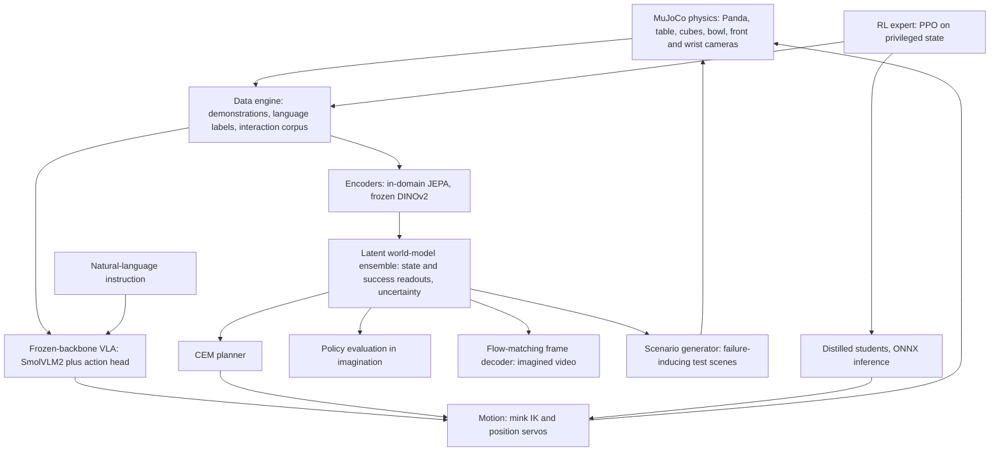

# Roadmap: Robot Foundation Models Testbed

This is a step-by-step build plan. The project is a simulated Franka Panda arm in MuJoCo, used as a controlled testbed for robot foundation models: vision-language-action models, JEPA representations, predictive and generative world models, and distillation. Every model is benchmarked on the same tasks and seeds:

1. A MuJoCo environment and a scripted expert (off-the-shelf IK, no custom kinematics or control code)
2. Reinforcement learning (PPO) trained from scratch into a privileged-state expert and demonstrator
3. A data engine: versioned demonstration datasets with language labels, and an interaction corpus for world models
4. A frozen-backbone VLA baseline built on a pretrained open VLM
5. An in-domain JEPA trained from scratch on T3-L1, compared by probing with a random encoder, a supervised encoder, and frozen DINOv2
6. Latent world models with calibrated uncertainty, benchmarked against physics-based models, rendered to video by a flow-matching frame decoder, and used for planning, policy evaluation, and generating failure-inducing test scenarios
7. Distillation of the privileged RL expert into small, fast vision students, and of the flow-matching frame decoder into a few-step sampler, with measured inference latency

**Compute budget.** Everything runs on the reference laptop (§1). Models are sized so that each training run takes about an hour (*estimates* until measured); features from frozen backbones are cached once and reused, and the most expensive model (an end-to-end JEPA encoder) is trained once per configuration rather than once per ensemble member.

Work through the phases in order. Every step ends with a **Check** that must pass before moving on. Every phase ends with a **Done when** gate.

---

## Contents

1. [Outcomes](#1-outcomes)
2. [Architecture](#2-architecture)
3. [Fixed design decisions](#3-fixed-design-decisions)
4. [Tasks and success predicates](#4-tasks-and-success-predicates)
5. [Evaluation rules](#5-evaluation-rules)
6. [Tech stack and repository layout](#6-tech-stack-and-repository-layout)
7. [Phase 0: Setup and scene](#phase-0-setup-and-scene)
8. [Phase 1: Environment and scripted expert](#phase-1-environment-and-scripted-expert)
9. [Phase 1b: Reinforcement learning (training an RL expert)](#phase-1b-reinforcement-learning-training-an-rl-expert)
10. [Phase 2: Data engine](#phase-2-data-engine)
11. [Phase 3: VLA baseline](#phase-3-vla-baseline)
12. [Phase 4: In-domain JEPA](#phase-4-in-domain-jepa)
13. [Phase 5: Latent world models](#phase-5-latent-world-models)
14. [Phase 6: Distillation and efficient inference](#phase-6-distillation-and-efficient-inference)
15. [Phase 7: Benchmark, packaging, and release](#phase-7-benchmark-packaging-and-release)
16. [Core and optional components](#16-core-and-optional-components)
17. [Fallbacks](#17-fallbacks)
18. [Future work](#18-future-work)

---

## 1. Outcomes

The project is complete when all of the following exist:

- A public repo where `make setup && make smoke` finishes in under 30 minutes from a clean clone. This excludes model-weight downloads and training.
- Unit tests for the environment: determinism, success predicates, and camera projection.
- A policy benchmark comparing the scripted expert, the RL expert, the BC baselines, the frozen-backbone VLA, distilled students, and world-model planning on shared tasks and seeds, with 95% confidence intervals, parameter counts, and latency, regenerated by `make benchmark`.
- A world-model report: prediction error against physics-based models, calibrated uncertainty, out-of-distribution detection, a validity map of where predictions can be trusted, planning results, and policy-evaluation correlation.
- A generative-model report: a flow-matching decoder that renders world-model latents to video, scored by the physical state recovered from generated frames, with its few-step distilled sampler's quality-latency trade-off.
- A scenario-generation report: failure-inducing test scenes found by a surrogate-guided search for a target policy, verified in MuJoCo, compared with uniform sampling.
- A representation study: a JEPA trained from scratch on T3-L1, probed for task state against a random encoder, a supervised encoder of the same architecture, and frozen DINOv2, plus predictor rollouts against persistence.
- A distillation study with a success-latency-size trade-off, including exported (ONNX) models.
- A 2-minute demo video: the world model's imagined rollout, decoded to frames, next to the real execution, a CEM-planned episode, a generated failure scenario, and the results tables.
- A README and a write-up with results, ablations, and limitations.

**Reference hardware.** One Apple Silicon laptop (M3 Max, 36 GB of unified memory). No NVIDIA GPU is used; every model is sized to train on this machine.

**Non-goals.** Real hardware, sim-to-real transfer, implementing kinematics, dynamics, or controllers, collision-aware motion planning, pretraining VLMs or training large VLAs and world models from scratch, large generative video models trained from scratch, multi-GPU training at scale (the training code is distributed-ready but runs on one machine), and novel algorithms. Phase 3 includes a supervised action-head baseline on a frozen pretrained VLM; it does not train the VLM itself.

---

## 2. Architecture



There are four layers, each usable and testable on its own:

1. **Physics:** a MuJoCo scene with the Panda, a table, colored cubes, a bowl, target zones, and two cameras.
2. **Motion and skills:** off-the-shelf IK (`mink`), MuJoCo's position servos, parameterized skills, and the scripted expert. No kinematics or control code is written.
3. **Experts and data:** the RL expert, trained on privileged state, and the data engine that turns it into versioned datasets.
4. **Learned models:** a frozen-backbone VLA baseline, encoders and probes, latent world models with planning, policy evaluation, a generative frame decoder, and scenario generation, and distilled students, all policies sharing one action interface.

---

## 3. Fixed design decisions

These apply everywhere. Each one is recorded, with its rationale, in `docs/decisions.md`.

| Topic | Decision |
| --- | --- |
| Robot | Franka Emika Panda from MuJoCo Menagerie (`franka_emika_panda`), arm plus hand, 7 DOF |
| Robot base | At the world origin, on the table surface (table top at z = 0), so `base` = `world` |
| Physics | `implicitfast` integrator, dt = 2 ms (500 Hz) |
| Joint control | Menagerie's built-in position servos; `data.ctrl` holds joint position targets |
| IK and interpolation | `mink` differential IK on a robot-only model, run at 100 Hz (every 5 physics steps); linear waypoint interpolation |
| Policy rate | 20 Hz (one environment step = 25 physics steps) |
| Action (all learned policies) | 5-D `[x, y, z, yaw, g]`: absolute TCP target in the base frame, gripper pointing straight down, `g` in [0, 1] (≥ 0.5 means open). The Phase 1b RL policy acts internally in bounded deltas (see the next row) that its wrapper integrates into this absolute command, so its `Policy` output is this same action. |
| Phase 1b RL policy action | Normalized deltas from the controller's current TCP target: xyz up to one rate-limit step (1.25 cm), yaw up to 0.05 rad, binary gripper |
| Action limits | xyz clipped to a workspace box in front of the base (about 45 × 60 × 40 cm above the table); yaw clipped to [−π/2, π/2] |
| Image observations | `observation.images.front` and `observation.images.wrist`, uint8 RGB, 256 × 256 for every dataset from Phase 2 on (the earlier BC baselines use 128 × 128) |
| State observation | `observation.state` = joint positions (7), gripper width (1), TCP position (3), TCP yaw (1) |
| Units | SI and radians everywhere |
| Frames | `world`, `base`, `ee` (TCP site), `cam_front`, `cam_wrist` |
| Quaternions | w, x, y, z (MuJoCo order). SciPy's `Rotation` defaults to x, y, z, w: always pass `scalar_first=True` or convert in one helper. |
| Rotation matrices | MuJoCo `xmat` arrays are row-major 9-vectors: `reshape(3, 3)` |
| Camera axes | MuJoCo cameras look along local −z with +y up (OpenGL). Convert to OpenCV axes (x right, y down, z forward) before using pinhole formulas. |
| Seed ranges | Train 0-99,999; validation 100,000-109,999; evaluation 1,000,000-1,009,999. Evaluation seeds are never used for training or tuning. |
| Randomness | One seeding utility. `np.random.SeedSequence(seed).spawn(...)` gives an independent stream for each purpose (scene, noise, policy). |

---

## 4. Tasks and success predicates

All predicates are implemented in code and frozen before any results are produced. An episode succeeds when its predicate holds and stays true for 1 s with the gripper open.

| ID | Task | Randomization | Success predicate | Time limit |
| --- | --- | --- | --- | --- |
| T1 | Reach a target point | target position | TCP within 5 mm of the target | 5 s |
| T2 | Place a 4 cm cube in an 8 × 8 cm target zone | cube pose, zone pose | cube center within 3 cm of the zone center (xy), cube at rest | 15 s |
| T3 | Place a cube in a bowl | cube pose, bowl pose, cube color | cube center inside the bowl's inner radius and below its rim, at rest | 15 s |
| T3-L | "Put the {color} cube in the bowl" with 2-3 cubes of different colors | poses, colors, which cube is named, instruction wording | named cube in the bowl; every other cube moved less than 2 cm | 15 s |
| T4 | Stack the red cube on the blue cube | both poses | red cube on the blue cube's top face within 1.5 cm (xy), at rest | 20 s |
| T5 | Multi-step language instructions combining T2-T4 | all of the above plus distractors | goal predicate for each instruction | 60 s |
| T2-H | T2 under dynamics shift | T2 plus the perturbations below | cube within 1 cm of the zone center and yaw aligned with the zone within 10° | 15 s |

**Randomization levels:**

- **L0:** fixed scene.
- **L1:** object and target poses.
- **L2:** L1 plus light position and color, table and object textures, 1-3 distractor objects, camera pose jitter (±1 cm, ±2°), and object friction and mass ±20%.

**T2-H perturbations** (evaluation only; randomized dynamics and noise parameters are hidden, while the state policy receives the noisy pose):

- target cube mass and inertia × Uniform[0.9, 1.1], sampled once per episode
- target cube geom friction × Uniform[0.9, 1.1], sampled once per episode
- independent zero-mean Gaussian noise on the target cube's observed position (σ = 0.15 mm per axis) and yaw (σ = 0.15°) at each state observation; this does not alter simulator state or the success predicate

These are calibrated in Phase 2 so that the Phase 1b T2 RL expert succeeds 40-75% of the time, then frozen in `envs/configs/t2_hard.yaml`.

---

## 5. Evaluation rules

- **Episodes per cell:**
  - Scripted and state-based methods: at least 100.
  - Image-based policies, including the frozen-backbone VLA and distilled students: at least 50.
  - World-model planners: at least 50.
  - RL: 3 training seeds × 100 evaluation episodes.
- **Confidence intervals:**
  - Success rates use the Wilson 95% interval. With $z = 1.96$, $\hat p$ the success fraction, and $n$ episodes, it is centered at $\dfrac{\hat p + z^2/2n}{1 + z^2/n}$ with half-width $\dfrac{z\sqrt{\hat p(1-\hat p)/n + z^2/4n^2}}{1 + z^2/n}$.
  - Comparisons across RL training seeds use a percentile bootstrap (10,000 resamples) over seeds × episodes.
- **Resolution:** at 50% success, the half-width is about ±13 points for n = 50, ±10 for n = 100, and ±7 for n = 200. Do not claim differences smaller than this.
- **World-model metrics:** prediction error vs horizon on decoded state (cm), interval coverage and Gaussian NLL for uncertainty, expected calibration error for success readouts, AUROC for out-of-distribution detection, and Pearson, Spearman, and MMRV for policy-evaluation correlation.
- **Latency:** p50 and p95 at batch size 1 on the reference laptop, with the backend and precision recorded.
- **Fairness:** every method gets the same scene, seeds, action limits, and time limit, and every planner gets the same goal observation. Report training data (demos or environment steps) and compute (CPU or MPS hours) for every method.
- **Reporting:** every evaluation writes JSON to `eval/results/`. Tables and figures are generated only from those files by `eval/report.py`; no number is entered by hand.
- **Run records:** every training run stores its config, git commit, seeds, dataset ID and version, and hardware in `run.json` next to its checkpoint.

---

## 6. Tech stack and repository layout

**Stack:**

- **Python 3.12** with `uv` and a committed lockfile.
- **`mujoco` 3.x** (a version `mink` supports) and **`mink`** for IK, both pinned.
- **MuJoCo Menagerie** as a git submodule pinned to a commit.
- **PyTorch ≥ 2.10** (MPS backend) and **`lerobot`**, pinned, with its `dataset` extra.
- **`transformers`**, pinned, for pretrained models (SmolVLM2, DINOv2).
- **`diffusers`**, pinned, only to load the frozen pretrained image autoencoder for the 5.9 frame decoder; the flow-matching models themselves are implemented in the repo.
- **TensorBoard** for experiment tracking, and **`onnx`** with **`onnxruntime`** for exported models.
- **`ffmpeg`** via Homebrew.
- **`gymnasium`** and **`stable-baselines3`**.
- **`pydantic`**, **`pytest`**, and **`mediapy`** or **`imageio`** for video.

**Repository layout:**

```text
.
├── Makefile
├── pyproject.toml / uv.lock
├── third_party/mujoco_menagerie/        # git submodule (pinned)
├── common/                              # seeding, transforms, config, run records
├── envs/                                # scene building, tasks, randomization, predicates, Gymnasium envs
│   └── configs/                         # task and level configs (YAML)
├── motion/                              # mink IK wrapper, control loop, waypoints
├── skills/                              # skills and scripted expert
├── data/                                # demo generation, dataset writing (datasets/ is gitignored)
├── policies/                            # PPO expert, BC baselines, frozen-backbone VLA, distilled students
├── encoders/                            # in-domain JEPA, frozen DINOv2 reference, frame cache, probes
├── world_models/                        # latent dynamics, readouts, uncertainty, planners, imagination evaluation, frame decoder, scenario generation
├── distill/                             # DAgger and teacher-student training, export and latency benchmarks
├── eval/                                # harness, statistics, report, results/
├── tests/                               # unit and smoke tests
├── scripts/                             # entry points for training, evaluation, video
└── docs/                                # conventions.md, decisions.md, figures, write-up
```

**Makefile targets:**

- `setup`: `uv sync` plus `git submodule update --init`
- `test`: unit tests
- `smoke`: tests plus one short episode per layer
- `demos`: generate datasets
- `train-*`: one target per method (`train-rl`, `train-vla`, `train-jepa`, `train-wm`, `train-decoder`, `distill`)
- `scenarios`: scenario search and the frozen stress-test suite
- `export`: ONNX export and latency benchmarks
- `benchmark`: all final evaluations
- `report`: tables and figures
- `video`: demo video

---

## Phase 0: Setup and scene

**Goal:** a reproducible repo and a simulation scene that compiles, renders, and has measured throughput.

### 0.1 Repository skeleton

- Create the layout above, plus `pyproject.toml` (Python 3.12), `uv.lock`, a `pytest` config with a `rendering` marker, the Makefile, and `.gitignore` (datasets, checkpoints, outputs, videos).
- Add a GitHub Actions workflow on Linux that runs `make test`. Skip tests marked `rendering` there.
- Add a license. Keep the third-party licenses (Menagerie models, model weights) and list them in the README.

**Check:** `make setup && make test` passes on a clean clone, both locally and in CI.

### 0.2 Robot assets

- Add MuJoCo Menagerie as a submodule at `third_party/mujoco_menagerie` and pin it to a commit.

**Check:** `python -m mujoco.viewer --mjcf=third_party/mujoco_menagerie/franka_emika_panda/scene.xml` opens and shows the Panda. Scripts that use the passive viewer (`mujoco.viewer.launch_passive`) must be launched with `mjpython` on macOS.

### 0.3 Conventions and shared utilities

- Write `docs/conventions.md` with the table in §3, and start `docs/decisions.md`.
- `common/seeding.py`: one function that turns a seed into named, independent NumPy generators.
- `common/transforms.py`: quaternion (w, x, y, z) ↔ rotation matrix, yaw extraction, and SciPy conversion helpers.

**Check:** quaternion → matrix matches `mujoco.mju_quat2Mat` on 1,000 random quaternions, and conversion round trips are exact to 1e-12.

### 0.4 Scene

Build the scene in `envs/scene.py` with `mujoco.MjSpec`, starting from Menagerie's `franka_emika_panda/scene.xml` (robot, floor, lights):

- **Table:** a static box whose top surface is at z = 0, under the robot base.
- **Cubes:** 4 cm free-floating bodies, 50-100 g each, one material per color.
- **Bowl:** a free body built from primitives: a thin cylinder base plus 12-16 thin boxes arranged in a ring as walls, about 7 cm inner radius and 5 cm tall.
- **Target zone:** a thin, visual-only box (`contype = 0`, `conaffinity = 0`).
- **TCP site:** on the hand body, at the midpoint between the fingertip pads (about 0.10 m along the hand's z axis; confirm visually).
- **Cameras:**
  - `front`: fixed, about 1 m from the workspace center and above it, pointing at the workspace.
  - `wrist`: attached to the hand body, looking along the gripper.
- **Contact settings:**
  - `cone = "elliptic"` with `impratio` around 10.
  - `condim = 4` on the fingertip geoms and the cubes.
  - Initial cube friction of 1.0.
- **Offscreen buffer:** set the visual `offwidth`/`offheight` at least as large as the largest rendered image (512 × 512).
- **Keyframes:** keyframes store full-length `qpos`. After adding free-floating objects, delete or rebuild any keyframe inherited from the robot file so its size matches `nq`.
- Look up joints, actuators, sites, and cameras **by name**, never by hard-coded index. Build the list of robot DOF indices from `model.jnt_dofadr`.

**Check:**

- The scene compiles and opens in the viewer.
- A test asserts the TCP site lies between the two fingertip geoms.
- A `rendering` test produces non-blank 128 × 128 images from both cameras.

### 0.5 Throughput baseline

- Measure physics steps per second, then frames per second for both cameras at 128 × 128, using `mujoco.Renderer(model, height, width)`, `update_scene(data, camera=...)`, and `render()`.

**Check:** both numbers are recorded in `docs/decisions.md`.

**Done when:** all Phase 0 checks pass in CI (except rendering tests) and locally.

---

## Phase 1: Environment and scripted expert

**Goal:** a Gymnasium environment, a closed-loop scripted expert solving T1-T4, and the evaluation harness every later phase uses.

### 1.1 IK with mink

Implement `motion/ik.py` as a thin wrapper around `mink`:

- Build a robot-only `MjModel` from Menagerie's `panda.xml` with the same TCP site, so free-floating objects never enter the IK problem. Each tick, copy the robot joint positions from the simulation into it.
- **Tasks:** a frame task on the TCP site (position and orientation), plus a low-weight posture task toward a fixed rest configuration so solutions stay smooth.
- **Limits:** joint position limits, plus optional joint velocity limits.
- **`step(target_pose, q) -> q_target`:** solve for joint velocities over 10 ms, integrate, and return the arm joint targets.
- **`solve(target_pose, q_init) -> (q, success)`:** repeat `step` until the TCP is within 1 mm and 0.5°, or 200 iterations.

**Check:** for 200 targets sampled in the workspace box (gripper pointing down, random yaw), `solve` succeeds at least 99% of the time, and every output is within joint limits.

### 1.2 Control loop and waypoints

Implement `motion/control.py`:

- `ControlLoop.apply(action)` runs one 20 Hz environment step. It repeats the following 5 times:
  1. Linearly interpolate the TCP target from the previous action to the new one.
  2. Run `ik.step` from the current measured configuration.
  3. Write the arm joint targets to `data.ctrl`.
  4. Advance the simulation with `mujoco.mj_step(model, data, nstep=5)`.
- **Gripper:** map `g` in [0, 1] onto the gripper actuator's `actuator_ctrlrange`, and confirm in the viewer which end means open.
- **Orientation:** build the target rotation as $R_z(\text{yaw})\,R_{down}$, where $R_{down}$ points the gripper straight down.
- **Waypoints:** skills move between TCP targets in straight lines, with a maximum TCP speed (for example 0.25 m/s) and a yaw-rate limit.

**Check:**

- Holding a fixed target, the TCP settles within 2 mm.
- A 30 cm straight-line move ends within 2 mm of the goal and stays within 1 cm of the line.

### 1.3 Grasping and contacts

- **Grasp detection** in `skills/grasp_check.py`:
  1. Scan `data.contact[:data.ncon]` and map geoms to bodies with `model.geom_bodyid`.
  2. A grasp holds when both finger bodies touch the target cube and the finger opening is above a "fully closed" threshold.
- **Lift check:** after lifting by 10 cm, the cube has risen by at least 8 cm.
- **Collision count:** contacts between robot links (excluding fingers) and the table or objects.
- **Tuning order when grasps slip:**
  1. Raise friction.
  2. Raise `impratio`.
  3. Check that `solref` is not stiffer than about 2× the timestep allows.
  4. Make cubes lighter or slightly larger.
  5. As a last resort, enable `noslip_iterations`.

  Record the final values in `docs/decisions.md`.

**Check:** grasp, lift, and hold for 3 s from 20 random cube poses, with less than 5 mm of slip in every trial.

### 1.4 Skills

Implement `skills/` with a shared result type, `SkillResult(success: bool, reason: str, info: dict)`. Every skill outputs a stream of 5-D actions at 20 Hz through the same `ControlLoop`, so skills, the expert, and learned policies all act through one interface.

**Skills:**

- `reach(pose)`: straight-line move to the pose. Succeeds when the TCP is within 5 mm and 5°.
- `grasp(obj)`:
  1. Open the gripper.
  2. Move to a pre-grasp 10 cm above the object, top-down. Because cubes are 90° symmetric, choose the grasp yaw equivalent to the cube's yaw that is nearest the current yaw.
  3. Descend, close, and verify the grasp.
  4. Lift 10 cm and verify the lift.
- `place(pose)`:
  1. Move to carry height above the target.
  2. Descend until the object is 5 mm above its resting height.
  3. Open, retreat, and verify the object is at rest within tolerance.
- `stack(a, b)`: `grasp(a)`, then `place` onto the top of `b`.
- `pick_and_place(obj, destination)`: `grasp(obj)`, then `place` at the destination (a zone center or inside a bowl).


**Failure reasons:** `unreachable`, `ik_failed`, `grasp_missed`, `slipped`, `collision`, `timeout`.

**Check:** each skill has a unit test on L0 scenes, including one forced-failure case per failure reason where feasible.

### 1.5 Scripted expert

- Implement `skills/expert.py` as a **closed-loop** policy, `act(obs) -> action`. A state machine (approach, descend, close, lift, carry, lower, release, retreat) recomputes each action from the current state and object pose, so it corrects deviations. Phase 2 noise injection depends on this.
- Support T1-T4 from oracle object poses, and T3-L from the named cube.

**Check:** on 20 L1 episodes per task, T1-T3 succeed at least 90% of the time and T4 at least 70%, before tuning further.

### 1.6 Gymnasium environment

Implement `envs/pick_place_env.py` as `PickPlaceEnv(task, level, obs_mode)`:

- **`reset(seed)`:** samples the scene from the task and level config using the seeded streams.
- **`step(action)`:** clips the action to the limits in §3, calls `ControlLoop.apply`, and returns the observation, reward, `terminated` (success held for 1 s), `truncated` (time limit), and `info`. `info` contains success, failure reason, collision count, and episode time.
- **Observation modes:**
  - `image`: both cameras plus `observation.state`.
  - `state`: `observation.state`, object poses, target pose.
  - Both modes can include the instruction string.
- **Randomization:** task and level configs live in `envs/configs/*.yaml`. L2 includes the visual randomization.
- **Instructions:** an `instruction` field for T3-L and T5 scenes.

**Check:**

- Same seed gives the same scene and trajectory, bit for bit.
- Different seeds give different scenes.
- The environment passes `gymnasium.utils.env_checker.check_env`.

### 1.7 Evaluation harness

Implement `eval/`:

- **Policy interface:** `Policy.reset(instruction=None)` and `Policy.act(obs) -> action`.
- **`evaluate(policy, task, level, seeds)`:** runs episodes in parallel worker processes, each creating its own environment and renderer. Writes `eval/results/<method>/<task>-<level>.json` with per-episode outcomes, failure reasons, timing, the git commit, and a config hash.
- **`eval/stats.py`:** the Wilson interval and percentile bootstrap.
- **`eval/report.py`:** builds Markdown tables and figures from the JSON files only.

**Check:**

- Wilson intervals match hand-computed values (for example 45/50 and 25/50).
- A rerun with the same seeds reproduces identical JSON (excluding timestamps).

### 1.8 Baseline evaluation

- Evaluate the expert on T1-T4 × L0-L2, 100 episodes per cell on evaluation seeds.
- Produce a failure breakdown by reason.

**Done when:**

- T1 ≥ 99%.
- T2 and T3 ≥ 90% at L1.
- T4 ≥ 70% at L1.
- All Phase 1 checks pass.
- The baseline table is generated by `make report`.

---

## Phase 1b: Reinforcement learning (training an RL expert)

**Goal:** train a pure-PPO policy from scratch, with no dependency on the scripted expert, that matches or beats it on every non-language task: T1, T2, T3, and T4. (T3-L and T5 need language conditioning and stay out of scope here; T3-L demonstrations reuse the T3 expert with the named cube as its target, see 2.2.) Freeze the result and use it as the demonstrator for the data engine (Phase 2) and as the privileged teacher for distillation (Phase 6).

Pure PPO is used here, rather than a residual policy on the scripted expert, because it does not inherit the scripted expert's failure modes.

### 1b.1 State-based RL environment

- **Action:** a normalized `[-1, 1]` delta from the controller's current TCP target, integrated by the wrapper into the absolute §3 action. xyz moves at most one rate-limit step (1.25 cm, norm-clipped); yaw moves at most 0.05 rad; the gripper is binary (open if the gripper component is positive). Zero holds still, so precision and holding are closed-loop. The same command tracker runs inside the frozen policy's `Policy.act`, which returns absolute actions.
- **Observation vector (36-D):**
  - joint positions (7) and gripper width (1)
  - TCP position (3) and yaw as (sin, cos)
  - the target object's position (3), its yaw as (sin 4θ, cos 4θ), and the grasp yaw error wrapped to [−π/4, π/4) (1). The 4θ encoding makes a cube's 90° symmetry explicit. Passing the named object's own pose, rather than hard-coding it by color, is what lets one policy per task generalize to naming an arbitrary object among distractors later (see 1b.3). For T1, this collapses to the reach target itself, since there is no object.
  - the destination pose (zone center, bowl center, the top of the stacking target, or the reach target for T1) (3)
  - relative vectors: object − TCP, destination − object (for T1, simply target − TCP)
  - command state: commanded target − TCP (3), commanded yaw − TCP yaw (1), last gripper command (1)
  - object displacement since the previous step (3)
- **Normalization:** wrap with `VecNormalize`, and save its statistics with each checkpoint.
- **Reward,** staged and dense, shared across tasks with a task-specific destination. Each step pays `(staged − max) / max ∈ [−1, 0]`, a small action-magnitude penalty, and +10 on success. Every stage's best value exceeds every earlier stage's, so the policy is always pulled forward, and per-step rewards are never positive, so finishing sooner always pays. `proximity(d)` averages `1 − tanh(k·d)` for k = 2, 8, 30 m⁻¹, giving a gradient both across the ≈0.5 m starting distance and within millimeters.
  - T1: `proximity(TCP-to-target) + gripper openness` (max 2)
  - T2-T4, not yet placed: `proximity(TCP-to-object) + grasped · (1 + proximity(object-to-carry-path))`. The carry path sits 6 cm above the destination and blends down to it within 5 cm horizontally, so it lifts, carries, then descends.
  - T2-T4, placed (object within 1.5 cm of the destination): `4 + gripper openness` (max 5). Releasing there never lowers the reward, and opening raises it.
- **Curriculum (training only):** 30% of object-task training episodes start with the cube already in a closed grasp, at a random lift of 0-8 cm. An optional `destination_start_fraction` (off by default) starts that fraction of grasped episodes at a random point along the path to the destination instead, 6-9 cm above it, so placing and releasing are practiced from the outset and long carries are learned backward from the goal. Use it for T3, whose bowl sits 30-50 cm from the cube (`--grasped-start-probability 0.5 --destination-start-fraction 0.6`). Both are opt-in `PickPlaceEnv` reset options driven by their own named seed stream. Validation and evaluation never use them.
- **Seeds:** unseeded training auto-resets draw only from the training seed range (§3).
- Run `stable-baselines3`'s `SubprocVecEnv` with 8-10 workers. Each worker builds its own MuJoCo model.

**Check:**

- Profile one environment step and record steps per second.
- Render 5 rollouts of a random policy per task to video and confirm the reward components behave as intended.
- The scripted expert, replayed through the delta action space, succeeds and passes through every reward stage.

### 1b.2 Train pure PPO per task

- Train one policy each for T1, T2, T3, and T4 at L1, sharing the observation and reward structure above.
- Start from these hyperparameters:
  - `n_envs=8`, `n_steps=2048`, `batch_size=1024`, `n_epochs=10`
  - `learning_rate=3e-4`, `gamma=0.99`, `gae_lambda=0.95`, `clip_range=0.2`, `target_kl=0.03`
  - policy and value networks of [256, 256], `log_std_init=-0.5`, `ent_coef=0` (gSDE and an entropy bonus are available as options, off by default)
- Budget up to 10-20 M environment steps per task, with a hard cap of 2 days of wall-clock per run. Use 3 training seeds per task.
- Resume a checkpoint only to extend its step budget; a reward or observation change requires a fresh run, because the value function and `VecNormalize` statistics depend on both.

**Check:** the learning curve (success on validation seeds every 100k steps) is logged for each task and seed. Each rollout's training success rate, stage funnel (reached, grasped, lifted, carried, placed), per-term reward sums, and PPO diagnostics (std, KL, explained variance) are logged to `logs/progress.csv`.

### 1b.3 Select and freeze the RL expert

- Evaluate every trained policy with the Phase 1.7 harness, on the same evaluation seeds used for the scripted expert's Phase 1.8 baseline.
- For each task, freeze the checkpoint (seed included) whose L1 success rate meets or exceeds the Phase 1 target for that task (T1 ≥ 99%, T2/T3 ≥ 90%, T4 ≥ 70%) and clearly exceeds the scripted expert's measured rate. Tag the commit and record the chosen checkpoints in `docs/decisions.md`.
- Wrap each frozen policy in the shared `Policy` interface, so it is a drop-in replacement for the scripted expert anywhere a `Policy` is expected: demo generation (2.1, 2.2) for T2-T4, the benchmark's RL-expert row, and the privileged teacher in 6.1. T1 has no downstream demo generation; its checkpoint exists to show the RL expert matches the scripted expert baseline across every non-language task.

**Check:** a table of the frozen RL expert's success rate next to the scripted expert's Phase 1.8 numbers, for T1, T2, T3, and T4 at L1.

**Done when:** every non-language task (T1, T2, T3, T4) has a frozen, qualifying RL-expert checkpoint, so Phase 2's demo generation can be repointed at the RL expert for T2 and T3. If a task's PPO run does not reach the target (see Fallbacks, §18), keep the scripted expert as that task's baseline and demo source, note it in the benchmark, and do not block later phases on the remaining tasks.

---

## Phase 2: Data engine

**Goal:** versioned datasets that every later phase trains on: RL-expert demonstrations with language labels for policies, and a broader interaction corpus for world models, plus the frozen T2-H definition and the shared training infrastructure.

### 2.1 Demonstration datasets

Extend `data/generate.py`:

- Run the frozen Phase 1b RL expert on **training seeds** across parallel workers, one renderer per worker (fall back to the scripted expert for any task without a qualifying RL-expert checkpoint, per §18). Record at 20 Hz:
  - `observation.images.front` and `observation.images.wrist` at 256 × 256 (§3)
  - `observation.state`
  - `action`: the clean expert action, and `action.executed`: the action actually applied
  - a `task` string per episode, for example "place the cube in the green zone" or "put the red cube in the bowl"
- Execute the expert action plus sparse Gaussian perturbations (σ = 1 cm in xyz, 3° in yaw) while labeling the clean action, so the data contains recoveries.
- Keep only successful episodes for the policy datasets and log the discard rate.
- Generate 400 successful episodes each for T2 and T3 at L1, with 5% held out for validation. T4 is optional (§16).

**Check:** the datasets load with `LeRobotDataset`; features, shapes, fps, and episode counts are as expected; spot-check frames from 5 episodes. Open-loop replay is an optional diagnostic, not a dataset acceptance gate: when requested with `--verify-open-loop`, collect without action noise and record the same-seed clean-action replay rate in the manifest. A rate below 95% emits a warning but does not reject the dataset; interpret it as a measure of feedback dependence, not demonstration validity.

> The existing 128 px T2-L1 dataset and BC checkpoints, collected from the scripted expert, remain comparison baselines; label them as scripted-expert baselines wherever they are reported.

### 2.2 Language-labeled data

- Add T3-L scenes (2-3 cubes in distinct colors, plus a bowl) and an instruction generator with templates and paraphrases ("put the red cube in the bowl", "place the red block into the bowl", "drop the red cube into the bowl").
- Split the templates into **train** and **held-out** sets for the paraphrase test.
- Generate 400 successful T3-L episodes with the T3 RL expert, given each scene's named cube as the target object, and store the instruction as the episode `task`.

**Check:** instructions are balanced across colors and templates, and held-out templates never appear in training data.

### 2.3 Interaction corpus for world models

World models must predict the outcome of actions an expert would not take, so they need broader action coverage than demonstrations provide.

- Collect T1, T2, and T3 episodes at L1 from a mixture of sources: the RL expert, the RL expert with large action noise, the RL expert's own failures, policies from intermediate PPO checkpoints, and scripted exploratory motion (random reachable targets with random gripper commands).
- Keep every episode, successful or not, and record the source, executed actions, a per-step success flag, and the object poses (`observation.environment_state`) for probing and evaluation.
- Target about 2,000 episodes; record per-source counts and action-coverage histograms.

**Check:** coverage histograms show executed actions spanning the workspace and both gripper states; per-source counts match the manifest.

### 2.4 Freeze T2-H

- Implement the T2-H perturbations from §4 in `reset`: independently sample one uniform mass scale and one uniform friction scale per episode for the target cube; scale `body_mass` and `body_inertia` together, and `geom_friction`, on the environment's own model copy, then call `mujoco.mj_setConst(model, data)`. Add independent Gaussian noise only to the target cube pose in state observations; do not perturb simulator state or the success checks.
- Use the T2 L1 scene distribution and keep T2-H evaluation-only. Run the frozen T2 RL expert for 200 episodes on validation seeds (`--checkpoint-dir checkpoints/rl/t2-l1/seed-0/best --task T2-H --level L1 --seed-start 100000 --episodes 200`) and adjust `envs/configs/t2_hard.yaml` until success is 40-75%, so the test has headroom in both directions.
- Freeze the config (`envs/configs/t2_hard.yaml`) and tag the commit.

**Calibration record:** `checkpoints/rl/t2-l1/seed-0/best` achieved 95/200 (47.5%, Wilson 95% CI 40.7-54.4%) on validation seeds 100,000-100,199 and 83/200 (41.5%, Wilson 95% CI 34.9-48.4%) on evaluation seeds 1,000,000-1,000,199 with the frozen config. The evaluation JSON is `eval/results/pure-ppo/T2-H-L1.json`.

**Check:** the RL expert's T2-H success on evaluation seeds is within 40-75%, and the config is tagged.

### 2.5 Shared training workflow

**Goal:** give every trainer one consistent run lifecycle without forcing BC, PPO, LeRobot, and future research models into one training loop. The shared PyTorch utilities live in `common/training.py`; each method keeps its own model-specific Pydantic config, data pipeline, optimization loop, validation rule, and native checkpoint format.

**How a run is created:** the method's training entry point chooses its usual run directory (under `checkpoints/bc/...`, `checkpoints/rl/...`, or the corresponding future method path) and starts a `TrainingRun` with its config, dataset ID/version, seeds, and runtime settings. `TrainingRun` creates the run directory and writes `run.json` plus TensorBoard event files. The method-specific trainer writes its native checkpoint alongside them:

```text
<method-specific run directory>/
├── run.json
├── tensorboard/                 # scalar events only
└── <native checkpoint files>   # written by the method adapter
```

The common run record captures the config, git commit and dirty-worktree status, train/validation seeds, dataset ID and version, hardware, selected precision and any fp32 fallback, and run status. TensorBoard tracks scalar losses, gradient norms, learning rates, and throughput; do not log parameter histograms or use Weights & Biases. `TrainingRun` does not create datasets, models, or a universal optimizer loop.

**Adapters and boundaries:**

- **BC:** adapt the existing PyTorch trainer to the shared run lifecycle and scalar logging. Keep its supervised loop, early stopping, validation metric, best-checkpoint selection, and checkpoint format.
- **PPO:** adapt the existing Stable-Baselines3 trainer through its logger/callback boundary. Keep SB3's rollout and update loop and preserve the `model.zip` plus `VecNormalize` checkpoint pair; do not replace it with the generic PyTorch checkpoint helper.
- **Phase 3 and later:** each LeRobot or research-model trainer connects through its supported backend interface. Native loops and checkpoints remain backend-owned; use the generic optimizer and DDP helpers only for trainers that directly own a PyTorch loop.

### 2.5.1 Shared run utilities

- Pydantic runtime settings and a common `run.json` record, using the method's full config and dataset lineage.
- TensorBoard scalar logging for losses, gradient norms, learning rate, and throughput.
- Mixed precision through `torch.autocast` where the backend supports it, with the selected precision or fp32 fallback recorded in `run.json`.
- Distributed helpers for `torchrun`, `DistributedDataParallel`, and rank-aware data sampling. Verify the generic PyTorch path locally with 2-process `gloo` on CPU.
- Resumable PyTorch checkpoints that capture model, optimizer, scheduler, scaler, and per-rank random states; gradient clipping and non-finite loss/gradient/parameter guards that report the step.
- Integrate and smoke-test the existing BC and PPO entry points through adapters, confirming that their algorithm-specific validation and native checkpoints still work and that both produce the shared run metadata and TensorBoard scalars.

**Check:** a tiny generic model trains identically (same loss curve to tolerance) in one-process and two-process DDP runs from the same seed, and resumes bit-for-bit from a mid-run checkpoint. Short BC and PPO adapter smoke runs also write the shared record and TensorBoard scalars while retaining their existing checkpoint formats.

**Done when:** the T2, T3, and T3-L demonstration datasets and the interaction corpus exist with manifests and versions, T2-H is frozen, and the training utilities pass their checks.

---

## Phase 3: VLA baseline

**Goal:** establish a frozen-backbone VLA baseline from an existing open VLM and evaluate it on language-conditioned tasks and under distribution shift. The baseline measures direct VLM-feature-to-action mapping.

### 3.1 Frozen-backbone VLA baseline from a pretrained small VLM

- Start from the frozen `HuggingFaceTB/SmolVLM2-500M-Video-Instruct` checkpoint (about 500M parameters, Apache-2.0; see the model card linked in `docs/decisions.md`). Do not train the VLM itself.
- Put the T3-L instruction before both 256 × 256 camera images in the prompt, so the image tokens can attend to it. Read the frozen VLM's mid-layer hidden states at both cameras' image tokens (one untiled view per camera, keeping its spatial token grid) and at the final prompt token. Standardize them, combine them with the 12-D `observation.state`, and train a small action head (a shared per-token linear projection followed by an MLP) on the T3-L training demonstrations. The head predicts a chunk of the next 10 actions (0.5 s) as changes from the current TCP pose plus gripper logits. The `Policy` re-plans every few steps, blends the overlapping chunks, and emits one absolute `[x, y, z, yaw, g]` command per 20 Hz step. The VLM stays frozen.
- Use the clean `action` label, and wrap the result in the shared `Policy` interface. Pin a Transformers version compatible with this checkpoint and the project's PyTorch/LeRobot environment before building the adapter; do not assume that the model card's inference examples establish MPS support.
- Run a short MPS feasibility test and a T3-L smoke rollout with different color instructions. Keep the train templates for fitting and use a held-out template for the instruction-following check.

**Check:** the VLM loads on the reference laptop, the action head trains with decreasing action loss, it emits finite in-range 5-D actions through `Policy`, and its behavior responds to the requested cube color. Record memory, steps per second, and the selected model revision in `docs/decisions.md`. This is an integration baseline, not a reportable benchmark result; any reportable success rate still follows §5.

### 3.2 Experiments

- **Frozen-backbone VLA baseline:** record T3-L success, wrong-object rate, and inference latency; compare with image BC where task support overlaps.
- **Distribution shift:** train on L1, evaluate on L2 (lighting, textures, distractors, camera jitter).
- **Language grounding on T3-L:** success rate and **wrong-object rate** (a cube other than the named one moved more than 2 cm or ended in the bowl), on train and held-out paraphrases.

**Done when:** the frozen-backbone VLA's T3-L results at L1 and L2 and on held-out paraphrases, with confidence intervals and the wrong-object rate, are generated by `make report`.

---

## Phase 4: In-domain JEPA

**Goal:** one experiment. Train a small JEPA from scratch on T3-L1 video and actions, and measure how much of the task state it encodes compared with a random encoder, a supervised encoder of the same architecture, and frozen DINOv2. The full design, hypotheses, and implementation plan are in [`docs/jepa.md`](jepa.md).

**Status:** complete. H1 passes (cube error 6.7 cm against 8.6 cm for the random encoder); DINOv2 is chosen for the Phase 6 T3-L1 student. Results are in `docs/decisions.md`.

**Budget:** about 1 h per training run on the reference laptop, and about 2.5 h for the whole phase in runs of 1 h or less. The front camera is encoded at 160 px and the wrist camera at 112 px; at the measured 0.54 s per step (fp32, batch 64), runs are capped at 6,000 steps, and λ is swept over 3 values by stopping each seed-0 run after 1,000 steps, then resuming the winner as final seed 0. The JEPA's action-conditioned predictor is the project's first latent world model; Phase 5 reuses the recipe, the frame cache, and the probes.

### 4.1 Data

- **Training:** the 1,046 training-seed T3-L1 episodes that already exist: the T3 slice of the Phase 2 interaction corpus (666 episodes, every source) and the `t3-l1` demonstrations (380 episodes).
- **Held-out:** with the interaction collector and the same source mixture, collect `t3-l1-probe-val` (100 episodes on validation seeds) for selecting hyperparameters and `t3-l1-probe-test` (200 episodes on evaluation seeds) for final numbers only. The collector gains a task filter and a held-out seed mode; the training corpus keeps its training-seed check.
- Decode front (160 px) and wrist (112 px) frames once at 5 Hz into a gitignored cache. A training window is 4 consecutive timesteps of one episode plus the 3 blocks of 4 executed actions between them.
- Derive probe labels from logged state, never model inputs: cube position and yaw, bowl position, TCP position, gripper width, a geometric "held" flag, and a cube-in-bowl flag.

**Check:** windows never cross episodes; each action block holds the 4 executed actions that follow its frame; the held-out manifests show the seed ranges and source mixture.

### 4.2 Model and training

- A LeWorldModel-style JEPA trained end to end from pixels: a ViT-Tiny/16 encoder shared by both cameras, with a BatchNorm projector to a 256-D latent; a 6-block causal transformer predictor over a 3-step latent history, conditioned on the action blocks through AdaLN-zero. No proprioception, pretrained weights, or labels.
- Loss: next-embedding MSE plus $\lambda$ · SIGReg, with no stop-gradient or EMA target. Implement it in the repo from the papers.
- Select $\lambda$ by validation linear-probe error; train the final configuration with one seed (the compute budget; intervals cover test episodes, not training seeds).
- Monitor collapse (per-dimension standard deviation and effective rank of the latents) and the prediction loss relative to persistence.

**Check:** the loss decreases without collapse, and the measured step time, memory, precision, and selected $\lambda$ are recorded in `docs/decisions.md`.

### 4.3 Probes and rollouts

- Fit linear and small-MLP probes on frozen features of the training episodes and score them on `t3-l1-probe-test` for four encoders: the JEPA, a randomly initialized encoder of the same architecture, the same architecture trained on the probe labels, and frozen DINOv2 ViT-S/14 (`facebook/dinov2-small`). Report cube error separately for a resting and a held cube. Confidence intervals come from a bootstrap over test episodes.
- Roll the predictor out 0.2–1.0 s with the recorded actions, decode the predicted latents with the probe, and compare with persistence.

**Check:** the JEPA's 95% confidence interval for linear-probe cube-position error lies entirely below the random encoder's.

**Done when:** the probe table and the rollout figure are generated by `make report`, and the encoder for the Phase 6 T3-L1 student (the JEPA or DINOv2) is chosen on `t3-l1-probe-val` and recorded in `docs/decisions.md`.

---

## Phase 5: Latent world models

**Goal:** action-conditioned world models that predict how the scene evolves under candidate action sequences, report calibrated uncertainty and out-of-distribution signals, are characterized for where their predictions can be trusted, are benchmarked against physics-based models, render their predictions to video through a generative decoder, and drive planning, policy evaluation, and the generation of failure-inducing test scenarios.

### 5.1 Data and interface

- Build transition datasets from the Phase 2 interaction corpus, split by episode seed. The world model runs at 5 Hz (every 4 policy steps), taking the 4 intermediate 5-D actions as its action input. Record the rate and action encoding in `docs/decisions.md`.
- Define `WorldModel.predict(observation_history, actions) -> latents, readouts, uncertainty` so planners and evaluators share one interface.

### 5.2 Model

- An action-conditioned transformer predictor over frozen encoder tokens from both cameras plus proprioception, following DINO-WM: teacher-forced one-step prediction plus a multi-step rollout loss.
- Train on frozen DINOv2 features, and an end-to-end LeWorldModel-style variant: the Phase 4 JEPA recipe retrained on the full interaction corpus (the Phase 4 model sees only T3 frames).
- Train an ensemble of 5 predictors per configuration with different seeds and data order, using the Phase 2.5 training infrastructure. To fit the compute budget, encoders are trained or run once and their features cached: the DINOv2 ensemble shares the frozen encoder, and the end-to-end variant trains its encoder once, then trains 4 more predictors on its frozen latents. Encoder uncertainty is therefore not represented; state this wherever ensemble uncertainty is reported.

**Check:** one-step validation error is well below a copy-last-frame baseline, and multi-step error grows smoothly with horizon.

### 5.3 Readouts

- **State readout:** a head decoding object poses and gripper width from latents, so predictions are interpretable in cm.
- **Success readout:** a head predicting the task's success predicate from latents, used for policy evaluation.
- **Pixel readout:** the generative frame decoder in 5.9; it is used for visualization and checking, not for planning.

**Check:** readouts on encoded ground-truth frames match the simulator within the probe accuracy from 4.3.

### 5.4 Physics baselines

Compare the learned models against classical models on the same action sequences:

- **MuJoCo with true parameters:** copy the simulator state and roll the action sequence through the same control loop. This is exact under known dynamics and sets the upper bound.
- **MuJoCo with nominal parameters under T2-H:** the same, but with the unperturbed mass and friction, a physics model with parameter error.
- **Kinematic model:** the cube is static unless grasped, and moves rigidly with the gripper while grasped.

**Check:** prediction error vs horizon (decoded object position, cm) for every learned and classical model, plus compute per predicted step, is generated by `make report`. State where each classical model is more accurate than the learned models.

### 5.5 Uncertainty and out-of-distribution signals

- **Predictive uncertainty:** ensemble disagreement on decoded state, calibrated on validation seeds by variance scaling, then evaluated on test seeds with interval coverage (fraction of true values within ±1σ and ±2σ), Gaussian NLL, and rank correlation between predicted uncertainty and actual error.
- **Success calibration:** expected calibration error and reliability diagrams for the success readout.
- **Out-of-distribution detection:** AUROC for separating L1 from L2, T2-H, and unseen cube colors, using ensemble disagreement and one-step surprise (prediction error on observed transitions) as scores.

**Check:** calibration plots and the OOD AUROC table are generated by `make report`.

### 5.6 Validity map

- Measure prediction error and calibration across horizon (0.2-3 s), randomization level (L0, L1, L2), dynamics shift (T2-H mass and friction scales), task phase (free motion, contact, carrying, release), and training data (demonstrations only vs the full interaction corpus).
- Define the trusted region as the conditions where calibrated error stays below a stated threshold (for example, 1 cm on decoded object position) and report it.

**Check:** the validity map and the trusted-region summary are generated by `make report`.

### 5.7 Planning

- **Model-predictive control in latent space:** CEM (MPPI optional) over 5 Hz action sequences, minimizing the L1 distance between predicted and goal embeddings, with a horizon of about 5 planning steps and replanning after each executed step.
- **Goals:** the goal observation is the final frame of the RL expert's successful episode on the same seed, supplied identically to every planner. It specifies the goal and is never used for training.
- **Uncertainty-aware planning:** add a penalty on ensemble disagreement to the planning cost, and compare with and without it.
- **Physics-model MPC:** the same CEM planner with MuJoCo (true parameters) as the model, as the upper bound.
- Evaluate on T1 and T2 at L1, and T2 under T2-H. Report success and planning time per action.

**Check:** planning results with confidence intervals for the learned and physics models, with and without the uncertainty penalty, are generated by `make report`.

### 5.8 Policy evaluation in imagination

- Roll policies out inside the world model from the start observations of evaluation scenes, closing the loop through each policy, and score each rollout with the success readout. Each policy receives what the world model supplies: decoded state for state-based policies, and predicted encoder features for policies on frozen encoder features.
- Use at least 8 policies with a spread of real success rates: RL-expert checkpoints from different training steps, the BC baselines, and the Phase 6 students.
- Report Pearson and Spearman correlation between predicted and real success, and the mean maximum rank violation (MMRV, from SIMPLER).

### 5.9 Generative frame decoder

A conditional flow-matching model that turns world-model latents into front-camera frames, so imagined rollouts can be watched and checked against the simulator. Conditioning only on the latent makes the decoder a direct test of what the latent encodes.

- **Model:** latent flow matching. A frozen, pretrained image autoencoder (for example, the Stable Diffusion VAE; pin the revision and confirm its license before use) maps 160 px front frames from the Phase 4 frame cache to a small spatial latent, cached once. A small DiT or U-Net (≈ 20–40M parameters) learns the linear-path flow from noise to that latent, conditioned on the world-model latent through AdaLN. Train one decoder per world-model configuration from 5.2.
- **Training:** on encoder latents of real frames from the interaction corpus training split; at test time it decodes predicted latents. Sample with Euler integration from noise drawn from a named seed stream.
- **Physical consistency metric:** on `t3-l1-probe-test` frames, where the Phase 4 probes apply, re-encode generated frames with frozen DINOv2 and apply the Phase 4 linear probes for cube, bowl, and TCP position and gripper width; report the error against the simulator's true state. Two floors separate decoder error from readout error: the same probe on real frames, and on autoencoder reconstructions of real frames. PSNR against the real frame is secondary, because a frame can be sharp and physically wrong.
- **Rollout video:** decode predicted latents along 5.2 rollouts and report the physical-consistency error against horizon, next to the latent readout's error at the same horizons.
- **Step distillation:** distill the $K$-step teacher sampler into a 1- and 2-step student by regressing the teacher's ODE endpoint from the same noise. Report physical-consistency error and latency at batch size 1 against the number of sampling steps, for the teacher at several $K$ and for the students.

**Check:** on encoded ground-truth frames, decoded cube-position error is within 2× the autoencoder-reconstruction floor; the step-distillation table and a rollout video are generated by `make report` and `make video`; training time, memory, and the selected $K$ are recorded in `docs/decisions.md`.

### 5.10 Scenario generation for stress testing

Search the existing scene distribution for scenarios that make a target policy fail, the way a simulator for autonomy testing generates safety-critical cases, and measure how much a learned surrogate speeds up the search over uniform sampling.

- **Scenario:** an explicit parameter vector inside the existing T3-L ranges at L1, and at L2 for the visual factors: cube and bowl poses, cube colors and count, the named cube, the instruction template (train templates only), and the L2 lighting, texture, distractor, and camera-jitter parameters. Add a `PickPlaceEnv` reset option that accepts explicit parameters and rejects values outside the level's ranges, so the search never widens §4.
- **Policy under test:** the frozen-backbone VLA from Phase 3 on T3-L. The Phase 6 students can be tested the same way once they exist.
- **Search:** CEM over scenario parameters (Gaussian for continuous, categorical for discrete), with restarts to cover several failure modes. Candidates are ranked by a surrogate: a failure classifier on frozen encoder features (DINOv2 or the 5.2 world-model encoder) of the rendered initial observation plus the scenario parameters, refit after each round on the verified rollouts. For policies on frozen encoder features, imagined rollouts scored by the success readout (5.8) are a second surrogate.
- **Verification:** every scenario counted as a failure is a real MuJoCo rollout of the policy, scored by the frozen §4 predicate and the wrong-object rule of 3.2.
- **Baselines:** uniform sampling of the same ranges, and CEM that verifies every candidate in MuJoCo with no surrogate, each with the same budget of verified rollouts (for example, 400).
- **Seeds and use:** search randomness and any rendering noise come from the validation seed range. The resulting stress-test suite is frozen as a scenario list in `envs/configs/` and reported separately from the §5 benchmark cells; it is never used to train or tune the policy it tests.

**Check:** verified failures per 100 rollouts with Wilson intervals for each search method, the number of distinct failure reasons found, and the surrogate's AUROC on held-out verified rollouts are generated by `make report`; replaying any suite scenario reproduces its failure exactly.

**Budget:** VLA rollouts dominate, at about 40 s per episode on MPS (*estimate*: 150 VLM queries of about 0.27 s), so three methods × 400 rollouts take about 13 h. Halve the budget per method if needed and record it.

**Done when:** the prediction-error, calibration, OOD, validity-map, physics-comparison, planning, policy-evaluation, frame-decoder, and scenario-generation results are generated by `make report`. No success threshold is set for planning; results are reported as measured.

---

## Phase 6: Distillation and efficient inference

**Goal:** small, fast vision students distilled from the privileged RL expert, and a measured success-latency-size trade-off.

### 6.1 Privileged teacher to vision student

- **Teacher:** the RL expert, which sees privileged state. **Student:** a policy on frozen DINOv2 ViT-S/14 features, which sees only cameras and proprioception. DINOv2 is used for every task, including T3-L1: it beat the Phase 4 JEPA on the validation probes (see `docs/jepa.md`).
- Train with DAgger: roll out the student, label every visited state with the teacher's action, aggregate, and retrain. Compare with offline behavior cloning on the same number of labeled frames.

**Check:** success vs labeled frames for DAgger and offline BC on T2-L1, T3-L1, and T2-L2.

### 6.2 Efficient inference

- Export the students, the world-model predictor, and the distilled 5.9 frame-decoder student to ONNX and run them with ONNX Runtime (CPU and Core ML execution providers). Also measure `torch.compile` and dynamic int8 quantization.
- Report p50 and p95 latency at batch size 1, memory, and the change in success rate (for the decoder, the change in physical-consistency error), with the backend and precision recorded.

**Done when:** a success vs latency vs parameter-count Pareto table and plot covering the RL expert, the students, and their exported variants are generated by `make report`.

---

## Phase 7: Benchmark, packaging, and release

**Goal:** a frozen, reproducible benchmark and a public release.

### 7.1 Freeze

- Tag the final configs and seeds.
- Add a download script so `make benchmark` runs every final evaluation from published checkpoints and `make report` regenerates every table and figure.

**Check:** on a clean clone, `make setup && make smoke` completes in under 30 minutes, and `make benchmark && make report` reproduces the published tables.

### 7.2 Final runs

Run the final evaluations under the rules in §5 and generate:

- **Policies:** scripted expert, RL expert, state and image BC baselines, the frozen-backbone VLA, the distilled students, and world-model MPC. Columns: T2-L1, T3-L1, T2-L2, T2-H, and T3-L where supported, plus parameters, latency, training data, and compute. Unsupported cells are marked N/A.
- **World models:** prediction error vs horizon against the physics baselines, calibration, OOD AUROC, the validity map, planning, and policy-evaluation correlation.
- **Generative decoder:** physical-consistency error vs horizon and vs sampling steps, for the teacher and the distilled students.
- **Scenario generation:** verified failures per 100 rollouts for each search method, failure reasons, and the frozen stress-test suite.
- **Representations:** the Phase 4 probe table and predictor rollout figure.
- **Distillation:** the success-latency-size Pareto table.

**Check:** every number in the README traces back to a JSON file in `eval/results/`.

### 7.3 Demo video

- Render a 2-minute video with `scripts/make_video.py`: the world model's imagined rollout, decoded by the 5.9 frame decoder, next to the real execution, a CEM-planned episode, a stress-test scenario from 5.10 that the VLA fails, and the results tables.

**Check:** the video is regenerated by `make video`.

### 7.4 Documentation

- **README:** overview, architecture diagram, main results, how to reproduce, hardware and compute used, third-party licenses, and limitations.
- **Write-up:** what was built, the key findings with figures, where learned models beat physics-based models and where they do not, and next steps.
- **`docs/decisions.md`:** complete and consistent with the code.

**Done when:** CI is green, the lockfile and submodule are pinned, the license is present, seeds are documented, and the release is tagged.

---

## 16. Core and optional components

**Core:** the scene and determinism tests, the evaluation harness, the scripted expert, the RL expert, the Phase 2 datasets and training infrastructure, the frozen-backbone VLA baseline, the in-domain JEPA probe study (Phase 4), the latent world-model ensemble with physics baselines, uncertainty and OOD evaluation, the validity map, CEM planning on T1 and T2, policy evaluation in imagination (5.8), the generative frame decoder with its distilled few-step sampler (5.9), scenario generation with the classifier surrogate (5.10), one distilled student with measured latency, and the write-up.

**Optional, in decreasing priority:**

1. The imagined-rollout surrogate for scenario generation (5.10)
2. The JEPA surprise test (milestone M7 in `docs/jepa.md`)
3. T4 stacking for learned methods (it remains for the scripted and RL experts)

---

## 17. Fallbacks

| Problem | Fallback |
| --- | --- |
| Grasps slip or cubes spin | Follow the tuning order in 1.3. Then use lighter or larger cubes, add a regrasp on lift-check failure, and simplify object geometry. |
| IK integration stalls | Drive the hand with a mocap body welded to it, with the arm actuators removed |
| RL environment too slow | Profile, run IK only at 100 Hz, avoid per-step allocations, add workers |
| The Phase 1b RL expert does not beat the scripted expert on some task | Keep the scripted expert as that task's demo source, note it in the benchmark, and do not block later phases on every task. If pure PPO falls well short after about 10 M steps, the next options are off-policy SAC/TQC with HER (T2 is goal-conditioned), or PPO initialized by BC from scripted demos. Both depart from "pure PPO, no expert" and need a roadmap decision first. |
| T2-H gives no headroom | Re-run the 2.4 calibration before evaluating anything on it |
| LeRobot API or dataset-format churn | Pin a known-good version |
| JEPA training too slow or memory-bound on MPS | Halve the batch, use activation checkpointing, shorten the step budget, or train on the front camera only; record the change in `run.json` |
| JEPA collapse | Monitor per-dimension spread and effective rank; raise the SIGReg weight and check the BatchNorm projectors; as a last resort, switch to an EMA target encoder |
| World-model planning fails on pick-and-place | Plan toward intermediate goal frames from the expert's episode, shorten the horizon, and report T1 and partial-progress results |
| Imagination drifts on long rollouts | Train with longer rollout losses, shorten evaluation horizons, and report the horizon where correlation breaks down |
| Frame decoder too slow or memory-bound on MPS | Shrink the decoder, train at 112 px in pixel space without the autoencoder, or decode the front camera at a lower frame rate; record the change in `run.json` |
| Decoded frames look plausible but place the cube wrongly | Report the physical-consistency error as measured; it is a finding about the latent, not a decoder bug, when the reconstruction floor is low |
| The scenario surrogate is no better than chance | Report it, and fall back to CEM verified directly in MuJoCo with a halved budget |
| DAgger teacher labeling too slow | Label subsampled states and cache teacher outputs |
| Mixed precision unstable on MPS | Train in fp32 and record it in `run.json` |

---

## 18. Future work

- **Larger VLAs:** fine-tune π0.5 or GR00T N1.7 on a rented GPU and compare them with the frozen-backbone VLA.
- **Multi-GPU training:** run the world-model and JEPA training on a rented multi-GPU node with the existing DDP code, and report scaling efficiency.
- **Generative video world model:** replace the JEPA predictor and frame-decoder pair with one autoregressive latent flow-matching model over frame sequences, conditioned on actions, trained on a rented GPU.
- **Distributed data and evaluation:** run data collection, evaluation, and scenario search across machines with Ray.
- **Deployment:** TensorRT engines for the students and the world-model predictor on an NVIDIA GPU or Jetson.
- **Broader representation study:** probe pretrained encoders (V-JEPA 2 or 2.1, ResNet-18, DINOv3) alongside the in-domain JEPA, test at L2, and train closed-loop policies on each frozen encoder.
- **Pretrained world models:** evaluate V-JEPA 2-AC zero-shot planning and a generative video world model (for example, NVIDIA Cosmos) as policy evaluators against the in-repo models.
- **Standard benchmarks:** fine-tune and evaluate on LIBERO for comparability with published results.
- **Isaac Lab port:** reproduce the tasks in Isaac Lab for GPU-parallel RL and data generation.
- **Sim-to-real:** run the distilled students on an SO-101-class arm through LeRobot and measure the transfer gap.
