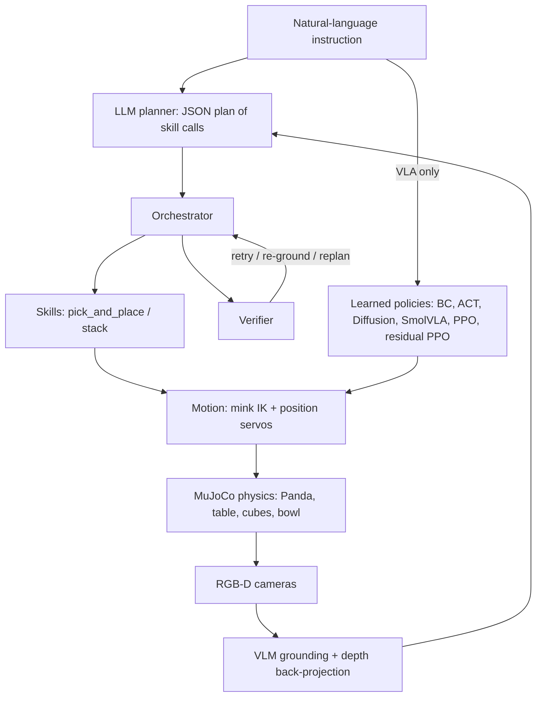

# Roadmap: Language-Driven Pick-and-Place Agent

This is a step-by-step build plan. The project is a simulated Franka Panda arm in MuJoCo that follows natural-language pick-and-place instructions. It is built in layers, and each layer is benchmarked on the same tasks and seeds:

1. A MuJoCo environment and a scripted expert (off-the-shelf IK, no custom kinematics or control code)
2. Reinforcement learning (PPO) trained from scratch into a stronger expert, used as the demonstrator for imitation learning
3. Imitation learning (BC, ACT, Diffusion Policy) trained on demonstrations from the RL-trained expert
4. A fine-tuned vision-language-action model (SmolVLA), also trained on the RL expert's demonstrations
5. Residual reinforcement learning refining the RL-trained expert under perturbed dynamics
6. An LLM/VLM agent with grounding, planning, verification, and recovery

Work through the phases in order. Every step ends with a **Check** that must pass before moving on. Every phase ends with a **Done when** gate.

---

## Contents

1. [Outcomes](#1-outcomes)
2. [Architecture](#2-architecture)
3. [Fixed design decisions](#3-fixed-design-decisions)
4. [Tasks and success predicates](#4-tasks-and-success-predicates)
5. [Evaluation rules](#5-evaluation-rules)
6. [Tech stack and repository layout](#6-tech-stack-and-repository-layout)
7. [Phase 0: Setup and scene](#phase-0-setup-and-scene)
8. [Phase 1: Environment and scripted expert](#phase-1-environment-and-scripted-expert)
9. [Phase 1b: Reinforcement learning (training an RL expert)](#phase-1b-reinforcement-learning-training-an-rl-expert)
10. [Phase 2a: Imitation learning](#phase-2a-imitation-learning)
11. [Phase 2b: VLA fine-tuning](#phase-2b-vla-fine-tuning)
12. [Phase 3: Residual reinforcement learning under perturbed dynamics](#phase-3-residual-reinforcement-learning-under-perturbed-dynamics)
13. [Phase 4: Agent layer](#phase-4-agent-layer)
14. [Phase 5: Benchmark, packaging, and release](#phase-5-benchmark-packaging-and-release)
15. [Core and optional components](#15-core-and-optional-components)
16. [Fallbacks](#16-fallbacks)
17. [Future work](#17-future-work)

---

## 1. Outcomes

The project is complete when all of the following exist:

- A public repo where `make setup && make smoke` finishes in under 30 minutes from a clean clone. This excludes model-weight downloads and training.
- Unit tests for the environment: determinism, success predicates, and camera projection.
- One benchmark table comparing the scripted expert, state BC, image BC, ACT, Diffusion Policy, SmolVLA, pure PPO, and residual PPO. It uses shared tasks and seeds, reports 95% confidence intervals, and is regenerated by `make benchmark`.
- An agent ablation (oracle vs VLM perception, local vs API models) with a failure taxonomy, plus an executor comparison: planner + scripted skills vs planner + SmolVLA skills vs SmolVLA end to end.
- A 2-minute demo video: a typed instruction, the plan, the execution, and one real failure with its recovery.
- A README and a write-up with results, ablations, and limitations.

**Reference hardware.** One Apple Silicon laptop with 36 GB of unified memory. No NVIDIA GPU is required. A rented GPU is optional for VLA fine-tuning.

**Non-goals.** Real hardware, sim-to-real transfer, implementing kinematics, dynamics, or controllers, collision-aware motion planning, training VLAs from scratch, and novel algorithms.

---

## 2. Architecture



There are four layers, each usable and testable on its own:

1. **Physics:** a MuJoCo scene with the Panda, a table, colored cubes, a bowl, target zones, and two cameras.
2. **Motion and skills:** off-the-shelf IK (`mink`), MuJoCo's position servos, parameterized skills, and the scripted expert. No kinematics or control code is written.
3. **Learned policies:** BC, ACT, Diffusion Policy, SmolVLA, PPO, and residual PPO, all using one action interface.
4. **Agent:** perception (oracle or VLM), LLM planner, verifier, recovery, and orchestrator. The agent's action API is the skill library, executed either by scripted skills or by the fine-tuned SmolVLA.

---

## 3. Fixed design decisions

These apply everywhere. Each one is recorded, with its rationale, in `docs/decisions.md`.

| Topic | Decision |
| --- | --- |
| Robot | Franka Emika Panda from MuJoCo Menagerie (`franka_emika_panda`), arm plus hand, 7 DOF |
| Robot base | At the world origin, on the table surface (table top at z = 0), so `base` = `world` |
| Physics | `implicitfast` integrator, dt = 2 ms (500 Hz) |
| Joint control | Menagerie's built-in position servos; `data.ctrl` holds joint position targets |
| IK and interpolation | `mink` differential IK on a robot-only model, run at 100 Hz (every 5 physics steps); linear waypoint interpolation |
| Policy rate | 20 Hz (one environment step = 25 physics steps) |
| Action (all learned policies) | 5-D `[x, y, z, yaw, g]`: absolute TCP target in the base frame, gripper pointing straight down, `g` in [0, 1] (≥ 0.5 means open). The Phase 1b RL policy acts internally in bounded deltas (see the next row) that its wrapper integrates into this absolute command, so its `Policy` output is this same action. |
| Phase 1b RL policy action | Normalized deltas from the controller's current TCP target: xyz up to one rate-limit step (1.25 cm), yaw up to 0.05 rad, binary gripper |
| Action limits | xyz clipped to a workspace box in front of the base (about 45 × 60 × 40 cm above the table); yaw clipped to [−π/2, π/2] |
| Residual-RL action | Bounded delta on the expert's xyz and yaw: ±2 cm, ±10° |
| Image observations | `observation.images.front` and `observation.images.wrist`, uint8 RGB, 128 × 128 |
| State observation | `observation.state` = joint positions (7), gripper width (1), TCP position (3), TCP yaw (1) |
| Units | SI and radians everywhere |
| Frames | `world`, `base`, `ee` (TCP site), `cam_front`, `cam_wrist` |
| Quaternions | w, x, y, z (MuJoCo order). SciPy's `Rotation` defaults to x, y, z, w: always pass `scalar_first=True` or convert in one helper. |
| Rotation matrices | MuJoCo `xmat` arrays are row-major 9-vectors: `reshape(3, 3)` |
| Camera axes | MuJoCo cameras look along local −z with +y up (OpenGL). Convert to OpenCV axes (x right, y down, z forward) before using pinhole formulas. |
| Seed ranges | Train 0-99,999; validation 100,000-109,999; evaluation 1,000,000-1,009,999. Evaluation seeds are never used for training or tuning. |
| Randomness | One seeding utility. `np.random.SeedSequence(seed).spawn(...)` gives an independent stream for each purpose (scene, noise, policy). |

---

## 4. Tasks and success predicates

All predicates are implemented in code and frozen before any results are produced. An episode succeeds when its predicate holds and stays true for 1 s with the gripper open.

| ID | Task | Randomization | Success predicate | Time limit |
| --- | --- | --- | --- | --- |
| T1 | Reach a target point | target position | TCP within 5 mm of the target | 5 s |
| T2 | Place a 4 cm cube in an 8 × 8 cm target zone | cube pose, zone pose | cube center within 3 cm of the zone center (xy), cube at rest | 15 s |
| T3 | Place a cube in a bowl | cube pose, bowl pose, cube color | cube center inside the bowl's inner radius and below its rim, at rest | 15 s |
| T3-L | "Put the {color} cube in the bowl" with 2-3 cubes of different colors | poses, colors, which cube is named, instruction wording | named cube in the bowl; every other cube moved less than 2 cm | 15 s |
| T4 | Stack the red cube on the blue cube | both poses | red cube on the blue cube's top face within 1.5 cm (xy), at rest | 20 s |
| T5 | Multi-step language instructions combining T2-T4 | all of the above plus distractors | goal predicate for each instruction | 60 s |
| T2-H | T2, harder (for RL) | T2 plus the perturbations below | cube within 1 cm of the zone center and yaw aligned with the zone within 10° | 15 s |

**Randomization levels:**

- **L0:** fixed scene.
- **L1:** object and target poses.
- **L2:** L1 plus light position and color, table and object textures, 1-3 distractor objects, camera pose jitter (±1 cm, ±2°), and object friction and mass ±20%.

**T2-H perturbations** (hidden from the expert):

- cube mass ×[0.5, 3]
- friction ×[0.5, 1.5]
- noise on object position (σ = 5 mm) and yaw (σ = 3°) in state observations

Calibrate these in Phase 3 so that the Phase 1b RL expert succeeds 40-75% of the time, then freeze them.

---

## 5. Evaluation rules

- **Episodes per cell:**
  - Scripted and state-based methods: at least 100.
  - Image-based policies, including SmolVLA: at least 50.
  - RL: 5 training seeds × 100 evaluation episodes.
  - Agent: each instruction × 3 scene seeds.
- **Confidence intervals:**
  - Success rates use the Wilson 95% interval. With $z = 1.96$, $\hat p$ the success fraction, and $n$ episodes, it is centered at $\dfrac{\hat p + z^2/2n}{1 + z^2/n}$ with half-width $\dfrac{z\sqrt{\hat p(1-\hat p)/n + z^2/4n^2}}{1 + z^2/n}$.
  - Comparisons across RL training seeds use a percentile bootstrap (10,000 resamples) over seeds × episodes.
- **Resolution:** at 50% success, the half-width is about ±13 points for n = 50, ±10 for n = 100, and ±7 for n = 200. Do not claim differences smaller than this.
- **Fairness:** every method gets the same scene, seeds, action limits, and time limit. Report training data (demos or environment steps) and compute (CPU, MPS, or GPU hours) for every method.
- **Reporting:** every evaluation writes JSON to `eval/results/`. Tables and figures are generated only from those files by `eval/report.py`; no number is entered by hand.
- **Run records:** every training run stores its config, git commit, seeds, dataset ID and version, and hardware in `run.json` next to its checkpoint.

---

## 6. Tech stack and repository layout

**Stack:**

- **Python 3.12** with `uv` and a committed lockfile.
- **`mujoco` 3.x** (a version `mink` supports) and **`mink`** for IK, both pinned.
- **MuJoCo Menagerie** as a git submodule pinned to a commit.
- **PyTorch ≥ 2.10** (MPS backend) and **`lerobot`**, pinned, with the `training`, `diffusion`, and `smolvla` extras.
- **`ffmpeg`** via Homebrew.
- **`gymnasium`** and **`stable-baselines3`**.
- **`pydantic`**, **`openai`** (as a generic client for OpenAI-compatible servers), **`pytest`**, and **`mediapy`** or **`imageio`** for video.
- **Local model serving** in a separate environment: Ollama, LM Studio, or `mlx-lm` / `mlx-vlm`, each exposing an OpenAI-compatible HTTP API. This keeps model dependencies out of the simulation environment.

**Repository layout:**

```text
.
├── Makefile
├── pyproject.toml / uv.lock
├── third_party/mujoco_menagerie/        # git submodule (pinned)
├── common/                              # seeding, transforms, config, run records
├── envs/                                # scene building, tasks, randomization, predicates, Gymnasium envs
│   └── configs/                         # task and level configs (YAML)
├── motion/                              # mink IK wrapper, control loop, waypoints
├── skills/                              # skills and scripted expert
├── data/                                # demo generation, dataset writing (datasets/ is gitignored)
├── policies/                            # BC, ACT, Diffusion, SmolVLA wrappers; PPO and residual PPO
├── agent/                               # perception, planner, verifier, orchestrator, skill executors, model client
│   └── instructions.yaml
├── eval/                                # harness, statistics, report, results/
├── tests/                               # unit and smoke tests
├── scripts/                             # entry points for training, evaluation, video
└── docs/                                # conventions.md, decisions.md, figures, write-up
```

**Makefile targets:**

- `setup`: `uv sync` plus `git submodule update --init`
- `test`: unit tests
- `smoke`: tests plus one short episode per layer
- `demos`: generate datasets
- `train-*`: one target per method
- `benchmark`: all final evaluations
- `report`: tables and figures
- `video`: demo video

---

## Phase 0: Setup and scene

**Goal:** a reproducible repo and a simulation scene that compiles, renders, and has measured throughput.

### 0.1 Repository skeleton

- Create the layout above, plus `pyproject.toml` (Python 3.12), `uv.lock`, a `pytest` config with a `rendering` marker, the Makefile, and `.gitignore` (datasets, checkpoints, outputs, videos).
- Add a GitHub Actions workflow on Linux that runs `make test`. Skip tests marked `rendering` there.
- Add a license. Keep the third-party licenses (Menagerie models, model weights) and list them in the README.

**Check:** `make setup && make test` passes on a clean clone, both locally and in CI.

### 0.2 Robot assets

- Add MuJoCo Menagerie as a submodule at `third_party/mujoco_menagerie` and pin it to a commit.

**Check:** `python -m mujoco.viewer --mjcf=third_party/mujoco_menagerie/franka_emika_panda/scene.xml` opens and shows the Panda. Scripts that use the passive viewer (`mujoco.viewer.launch_passive`) must be launched with `mjpython` on macOS.

### 0.3 Conventions and shared utilities

- Write `docs/conventions.md` with the table in §3, and start `docs/decisions.md`.
- `common/seeding.py`: one function that turns a seed into named, independent NumPy generators.
- `common/transforms.py`: quaternion (w, x, y, z) ↔ rotation matrix, yaw extraction, and SciPy conversion helpers.

**Check:** quaternion → matrix matches `mujoco.mju_quat2Mat` on 1,000 random quaternions, and conversion round trips are exact to 1e-12.

### 0.4 Scene

Build the scene in `envs/scene.py` with `mujoco.MjSpec`, starting from Menagerie's `franka_emika_panda/scene.xml` (robot, floor, lights):

- **Table:** a static box whose top surface is at z = 0, under the robot base.
- **Cubes:** 4 cm free-floating bodies, 50-100 g each, one material per color.
- **Bowl:** a free body built from primitives: a thin cylinder base plus 12-16 thin boxes arranged in a ring as walls, about 7 cm inner radius and 5 cm tall.
- **Target zone:** a thin, visual-only box (`contype = 0`, `conaffinity = 0`).
- **TCP site:** on the hand body, at the midpoint between the fingertip pads (about 0.10 m along the hand's z axis; confirm visually).
- **Cameras:**
  - `front`: fixed, about 1 m from the workspace center and above it, pointing at the workspace.
  - `wrist`: attached to the hand body, looking along the gripper.
- **Contact settings:**
  - `cone = "elliptic"` with `impratio` around 10.
  - `condim = 4` on the fingertip geoms and the cubes.
  - Initial cube friction of 1.0.
- **Offscreen buffer:** set the visual `offwidth`/`offheight` at least as large as the largest rendered image (512 × 512 for VLM grounding).
- **Keyframes:** keyframes store full-length `qpos`. After adding free-floating objects, delete or rebuild any keyframe inherited from the robot file so its size matches `nq`.
- Look up joints, actuators, sites, and cameras **by name**, never by hard-coded index. Build the list of robot DOF indices from `model.jnt_dofadr`.

**Check:**

- The scene compiles and opens in the viewer.
- A test asserts the TCP site lies between the two fingertip geoms.
- A `rendering` test produces non-blank 128 × 128 images from both cameras.

### 0.5 Throughput baseline

- Measure physics steps per second, then frames per second for both cameras at 128 × 128, using `mujoco.Renderer(model, height, width)`, `update_scene(data, camera=...)`, and `render()`.

**Check:** both numbers are recorded in `docs/decisions.md`.

**Done when:** all Phase 0 checks pass in CI (except rendering tests) and locally.

---

## Phase 1: Environment and scripted expert

**Goal:** a Gymnasium environment, a closed-loop scripted expert solving T1-T4, and the evaluation harness every later phase uses.

### 1.1 IK with mink

Implement `motion/ik.py` as a thin wrapper around `mink`:

- Build a robot-only `MjModel` from Menagerie's `panda.xml` with the same TCP site, so free-floating objects never enter the IK problem. Each tick, copy the robot joint positions from the simulation into it.
- **Tasks:** a frame task on the TCP site (position and orientation), plus a low-weight posture task toward a fixed rest configuration so solutions stay smooth.
- **Limits:** joint position limits, plus optional joint velocity limits.
- **`step(target_pose, q) -> q_target`:** solve for joint velocities over 10 ms, integrate, and return the arm joint targets.
- **`solve(target_pose, q_init) -> (q, success)`:** repeat `step` until the TCP is within 1 mm and 0.5°, or 200 iterations.

**Check:** for 200 targets sampled in the workspace box (gripper pointing down, random yaw), `solve` succeeds at least 99% of the time, and every output is within joint limits.

### 1.2 Control loop and waypoints

Implement `motion/control.py`:

- `ControlLoop.apply(action)` runs one 20 Hz environment step. It repeats the following 5 times:
  1. Linearly interpolate the TCP target from the previous action to the new one.
  2. Run `ik.step` from the current measured configuration.
  3. Write the arm joint targets to `data.ctrl`.
  4. Advance the simulation with `mujoco.mj_step(model, data, nstep=5)`.
- **Gripper:** map `g` in [0, 1] onto the gripper actuator's `actuator_ctrlrange`, and confirm in the viewer which end means open.
- **Orientation:** build the target rotation as $R_z(\text{yaw})\,R_{down}$, where $R_{down}$ points the gripper straight down.
- **Waypoints:** skills move between TCP targets in straight lines, with a maximum TCP speed (for example 0.25 m/s) and a yaw-rate limit.

**Check:**

- Holding a fixed target, the TCP settles within 2 mm.
- A 30 cm straight-line move ends within 2 mm of the goal and stays within 1 cm of the line.

### 1.3 Grasping and contacts

- **Grasp detection** in `skills/grasp_check.py`:
  1. Scan `data.contact[:data.ncon]` and map geoms to bodies with `model.geom_bodyid`.
  2. A grasp holds when both finger bodies touch the target cube and the finger opening is above a "fully closed" threshold.
- **Lift check:** after lifting by 10 cm, the cube has risen by at least 8 cm.
- **Collision count:** contacts between robot links (excluding fingers) and the table or objects.
- **Tuning order when grasps slip:**
  1. Raise friction.
  2. Raise `impratio`.
  3. Check that `solref` is not stiffer than about 2× the timestep allows.
  4. Make cubes lighter or slightly larger.
  5. As a last resort, enable `noslip_iterations`.

  Record the final values in `docs/decisions.md`.

**Check:** grasp, lift, and hold for 3 s from 20 random cube poses, with less than 5 mm of slip in every trial.

### 1.4 Skills

Implement `skills/` with a shared result type, `SkillResult(success: bool, reason: str, info: dict)`. Every skill outputs a stream of 5-D actions at 20 Hz through the same `ControlLoop`, so skills, the expert, and learned policies all act through one interface.

**Skills:**

- `reach(pose)`: straight-line move to the pose. Succeeds when the TCP is within 5 mm and 5°.
- `grasp(obj)`:
  1. Open the gripper.
  2. Move to a pre-grasp 10 cm above the object, top-down. Because cubes are 90° symmetric, choose the grasp yaw equivalent to the cube's yaw that is nearest the current yaw.
  3. Descend, close, and verify the grasp.
  4. Lift 10 cm and verify the lift.
- `place(pose)`:
  1. Move to carry height above the target.
  2. Descend until the object is 5 mm above its resting height.
  3. Open, retreat, and verify the object is at rest within tolerance.
- `stack(a, b)`: `grasp(a)`, then `place` onto the top of `b`.
- `pick_and_place(obj, destination)`: `grasp(obj)`, then `place` at the destination (a zone center or inside a bowl).

The agent's planner calls only `pick_and_place` and `stack`.

**Failure reasons:** `unreachable`, `ik_failed`, `grasp_missed`, `slipped`, `collision`, `timeout`.

**Check:** each skill has a unit test on L0 scenes, including one forced-failure case per failure reason where feasible.

### 1.5 Scripted expert

- Implement `skills/expert.py` as a **closed-loop** policy, `act(obs) -> action`. A state machine (approach, descend, close, lift, carry, lower, release, retreat) recomputes each action from the current state and object pose, so it corrects deviations. Phase 2 noise injection depends on this.
- Support T1-T4 from oracle object poses, and T3-L from the named cube.

**Check:** on 20 L1 episodes per task, T1-T3 succeed at least 90% of the time and T4 at least 70%, before tuning further.

### 1.6 Gymnasium environment

Implement `envs/pick_place_env.py` as `PickPlaceEnv(task, level, obs_mode)`:

- **`reset(seed)`:** samples the scene from the task and level config using the seeded streams.
- **`step(action)`:** clips the action to the limits in §3, calls `ControlLoop.apply`, and returns the observation, reward, `terminated` (success held for 1 s), `truncated` (time limit), and `info`. `info` contains success, failure reason, collision count, and episode time.
- **Observation modes:**
  - `image`: both cameras plus `observation.state`.
  - `state`: `observation.state`, object poses, target pose.
  - Both modes can include the instruction string.
- **Randomization:** task and level configs live in `envs/configs/*.yaml`. L2 includes the visual randomization.
- **Instructions:** an `instruction` field for T3-L and T5 scenes.

**Check:**

- Same seed gives the same scene and trajectory, bit for bit.
- Different seeds give different scenes.
- The environment passes `gymnasium.utils.env_checker.check_env`.

### 1.7 Evaluation harness

Implement `eval/`:

- **Policy interface:** `Policy.reset(instruction=None)` and `Policy.act(obs) -> action`.
- **`evaluate(policy, task, level, seeds)`:** runs episodes in parallel worker processes, each creating its own environment and renderer. Writes `eval/results/<method>/<task>-<level>.json` with per-episode outcomes, failure reasons, timing, the git commit, and a config hash.
- **`eval/stats.py`:** the Wilson interval and percentile bootstrap.
- **`eval/report.py`:** builds Markdown tables and figures from the JSON files only.

**Check:**

- Wilson intervals match hand-computed values (for example 45/50 and 25/50).
- A rerun with the same seeds reproduces identical JSON (excluding timestamps).

### 1.8 Baseline evaluation

- Evaluate the expert on T1-T4 × L0-L2, 100 episodes per cell on evaluation seeds.
- Produce a failure breakdown by reason.

**Done when:**

- T1 ≥ 99%.
- T2 and T3 ≥ 90% at L1.
- T4 ≥ 70% at L1.
- All Phase 1 checks pass.
- The baseline table is generated by `make report`.

> In practice, the scripted expert's measured success fell short of these targets on T3 and T4 (see `docs/decisions.md`). Rather than keep hand-tuning its state machine, Phase 1b trains an RL policy on the same tasks to serve as a stronger expert and the demonstrator for every phase from 2a onward. The scripted expert stays in the code and the benchmark as a baseline; it is simply no longer the source of training data.

---

## Phase 1b: Reinforcement learning (training an RL expert)

**Goal:** train a pure-PPO policy from scratch, with no dependency on the scripted expert, that matches or beats it on every non-language task: T1, T2, T3, and T4. (T3-L and T5 need language conditioning and stay out of scope here; they continue to use the scripted expert, see 2.6.) Freeze the result and use it as the demonstrator for Phase 2a and 2b, and as the base policy that Phase 3's residual RL later refines.

Pure PPO is used here, not residual PPO, specifically because it does not inherit the scripted expert's failure modes.

### 1b.1 State-based RL environment

- **Action:** a normalized `[-1, 1]` delta from the controller's current TCP target, integrated by the wrapper into the absolute §3 action. xyz moves at most one rate-limit step (1.25 cm, norm-clipped); yaw moves at most 0.05 rad; the gripper is binary (open if the gripper component is positive). Zero holds still, so precision and holding are closed-loop. The same command tracker runs inside the frozen policy's `Policy.act`, which returns absolute actions.
- **Observation vector (36-D):**
  - joint positions (7) and gripper width (1)
  - TCP position (3) and yaw as (sin, cos)
  - the target object's position (3), its yaw as (sin 4θ, cos 4θ), and the grasp yaw error wrapped to [−π/4, π/4) (1). The 4θ encoding makes a cube's 90° symmetry explicit. Passing the named object's own pose, rather than hard-coding it by color, is what lets one policy per task generalize to naming an arbitrary object among distractors later (see 1b.3). For T1, this collapses to the reach target itself, since there is no object.
  - the destination pose (zone center, bowl center, the top of the stacking target, or the reach target for T1) (3)
  - relative vectors: object − TCP, destination − object (for T1, simply target − TCP)
  - command state: commanded target − TCP (3), commanded yaw − TCP yaw (1), last gripper command (1)
  - object displacement since the previous step (3)
  - append a one-hot expert phase only when this environment is reused for residual RL in Phase 3; omit it here
- **Normalization:** wrap with `VecNormalize`, and save its statistics with each checkpoint.
- **Reward,** staged and dense, shared across tasks with a task-specific destination. Each step pays `(staged − max) / max ∈ [−1, 0]`, a small action-magnitude penalty, and +10 on success. Every stage's best value exceeds every earlier stage's, so the policy is always pulled forward, and per-step rewards are never positive, so finishing sooner always pays. `proximity(d)` averages `1 − tanh(k·d)` for k = 2, 8, 30 m⁻¹, giving a gradient both across the ≈0.5 m starting distance and within millimeters.
  - T1: `proximity(TCP-to-target) + gripper openness` (max 2)
  - T2-T4, not yet placed: `proximity(TCP-to-object) + grasped · (1 + proximity(object-to-carry-path))`. The carry path sits 6 cm above the destination and blends down to it within 5 cm horizontally, so it lifts, carries, then descends.
  - T2-T4, placed (object within 1.5 cm of the destination): `4 + gripper openness` (max 5). Releasing there never lowers the reward, and opening raises it.
- **Curriculum (training only):** 30% of object-task training episodes start with the cube already in a closed grasp, at a random lift of 0-8 cm. An optional `destination_start_fraction` (off by default) starts that fraction of grasped episodes at a random point along the path to the destination instead, 6-9 cm above it, so placing and releasing are practiced from the outset and long carries are learned backward from the goal. Use it for T3, whose bowl sits 30-50 cm from the cube (`--grasped-start-probability 0.5 --destination-start-fraction 0.6`). Both are opt-in `PickPlaceEnv` reset options driven by their own named seed stream. Validation and evaluation never use them.
- **Seeds:** unseeded training auto-resets draw only from the training seed range (§3).
- Run `stable-baselines3`'s `SubprocVecEnv` with 8-10 workers. Each worker builds its own MuJoCo model.

**Check:**

- Profile one environment step and record steps per second.
- Render 5 rollouts of a random policy per task to video and confirm the reward components behave as intended.
- The scripted expert, replayed through the delta action space, succeeds and passes through every reward stage.

### 1b.2 Train pure PPO per task

- Train one policy each for T1, T2, T3, and T4 at L1, sharing the observation and reward structure above.
- Start from these hyperparameters:
  - `n_envs=8`, `n_steps=2048`, `batch_size=1024`, `n_epochs=10`
  - `learning_rate=3e-4`, `gamma=0.99`, `gae_lambda=0.95`, `clip_range=0.2`, `target_kl=0.03`
  - policy and value networks of [256, 256], `log_std_init=-0.5`, `ent_coef=0` (gSDE and an entropy bonus are available as options, off by default)
- Budget up to 10-20 M environment steps per task, with a hard cap of 2 days of wall-clock per run. Use 3 training seeds per task here; the full 5-seed statistical comparison is reserved for Phase 3.
- Resume a checkpoint only to extend its step budget; a reward or observation change requires a fresh run, because the value function and `VecNormalize` statistics depend on both.

**Check:** the learning curve (success on validation seeds every 100k steps) is logged for each task and seed. Each rollout's training success rate, stage funnel (reached, grasped, lifted, carried, placed), per-term reward sums, and PPO diagnostics (std, KL, explained variance) are logged to `logs/progress.csv`.

### 1b.3 Select and freeze the RL expert

- Evaluate every trained policy with the Phase 1.7 harness, on the same evaluation seeds used for the scripted expert's Phase 1.8 baseline.
- For each task, freeze the checkpoint (seed included) whose L1 success rate meets or exceeds the Phase 1 target for that task (T1 ≥ 99%, T2/T3 ≥ 90%, T4 ≥ 70%) and clearly exceeds the scripted expert's measured rate. Tag the commit and record the chosen checkpoints in `docs/decisions.md`.
- Wrap each frozen policy in the shared `Policy` interface, so it is a drop-in replacement for the scripted expert anywhere a `Policy` is expected: demo generation (2.1, 2.6) for T2-T4, the benchmark's "pure PPO" row, and Phase 3's residual-RL base. T1 has no downstream demo generation; its checkpoint exists to show the RL expert matches the scripted expert baseline across every non-language task.

**Check:** a table of the frozen RL expert's success rate next to the scripted expert's Phase 1.8 numbers, for T1, T2, T3, and T4 at L1.

**Done when:** every non-language task (T1, T2, T3, T4) has a frozen, qualifying RL-expert checkpoint, so Phase 2a's demo generation can be repointed at the RL expert for T2 and T3. If a task's PPO run does not reach the target (see Fallbacks, §16), keep the scripted expert as that task's baseline and demo source, note it in the benchmark, and do not block Phase 2a and 2b on the remaining tasks.

---

## Phase 2a: Imitation learning

**Goal:** demo datasets in LeRobot format, plus BC, ACT, and Diffusion Policy trained, evaluated, and compared.

### 2.1 Demo generation

Implement `data/generate.py`:

- Run the frozen RL expert from Phase 1b on **training seeds** across parallel worker processes, one renderer per worker (fall back to the scripted expert for any task without a qualifying RL-expert checkpoint, per §16). Record at 20 Hz:
  - `observation.images.front` and `observation.images.wrist`
  - `observation.state`
  - `action`: the clean expert action
  - a `task` string for each episode, for example "place the cube in the green zone" or "put the red cube in the bowl"
- **DART-style noise:** execute the expert action plus Gaussian noise (σ = 1 cm in xyz, 3° in yaw) but record the clean expert action as the label, so the data contains recoveries.
- Keep only successful episodes and log the discard rate.
- Write with the LeRobot dataset API (create the dataset, add frames, save each episode) to `data/datasets/<name>/`, with fps = 20.
- Generate 400 successful episodes each for T2 and T3 at L1 (T4 optional). Hold out 5% of episodes for validation.

**Check:**

- The datasets load with `LeRobotDataset`, and the features, shapes, fps, and episode counts are as expected.
- Spot-check rendered frames from 5 episodes.
- A small noise-free set replayed open-loop from the same seeds succeeds at least 95% of the time.

> The T2-L1 datasets and BC checkpoints already collected from the scripted expert predate this change. Keep them as a historical, scripted-expert-demo baseline (labeled as such if reported), but regenerate datasets from the RL expert for all new training.

### 2.2 BC baselines

Implement in plain PyTorch (`policies/bc.py`) on the MPS device:

- **State BC:** an MLP over `observation.state` plus oracle object and target poses, predicting the 5-D action with L1 loss. This bridges the comparison with RL.
- **Image BC:** an ImageNet-pretrained ResNet-18 encoding each camera, with the features concatenated with `observation.state` and fed to an MLP head.
- Wrap both in the `Policy` interface.

**Check:** both train, and their validation loss decreases. State BC reaches at least 50% on T2-L1, which sanity-checks the data and action pipeline.

### 2.3 ACT

- Train ACT with the LeRobot training CLI (policy type `act`, device `mps`) on the T2 dataset. Start with chunk size 100, temporal ensembling off, and the ResNet-18 backbone.
- Before full runs, do a 1,000-step timing run and set step counts from it. If a full run would exceed about 12 hours, run it on a rented GPU.
- Wrap the checkpoint in the `Policy` interface. Use LeRobot's own policy loading and pre/post-processing so normalization matches training, and call `reset()` at episode start.
- **Fallback:** if integration stalls, implement a minimal ACT. It has a ResNet-18 encoder per camera, a transformer encoder-decoder over image tokens plus a state token, a CVAE encoder over the action chunk during training (KL weight about 10), L1 loss on chunks of 50-100 actions, and optional temporal ensembling at inference.

**Check:** ACT reaches at least 70% on T2-L1 (50 episodes).

### 2.4 Diffusion Policy

- Train Diffusion Policy with LeRobot on the T2 dataset. Use 2 observation steps, horizon 16, and 8 executed actions, and switch the noise scheduler to DDIM with about 10 inference steps for fast rollout.
- Train on MPS, or on a rented GPU if a run would exceed about 12 hours.

**Check:** the policy is evaluated on T2-L1 and results are in `eval/results/`.

### 2.5 Experiments

- **Data scaling:** ACT on T2-L1 with 25, 50, 100, 200, and 400 demos.
- **Robustness:** train on L1, evaluate on L2, for ACT, Diffusion Policy, and image BC.
- **ACT ablation:** chunk size {1, 10, 50, 100}, each with and without temporal ensembling.
- **Diffusion Policy ablation:** observation history of 1 vs 2 steps.
- **T3:** train and evaluate ACT on T3-L1.

**Done when:**

- At least one image-based policy reaches ≥ 70% on T2-L1.
- The data-scaling curve, the robustness table, and the ablation tables are all generated by `make report`.

---

## Phase 2b: VLA fine-tuning

**Goal:** a fine-tuned SmolVLA compared with ACT, and evaluated on language-conditioned tasks.

### 2.6 Language-labeled data

- Add T3-L scenes (2-3 cubes in distinct colors, plus a bowl) and an instruction generator with templates and paraphrases, for example:
  - "put the red cube in the bowl"
  - "place the red block into the bowl"
  - "drop the red cube into the bowl"
- Split the templates into **train** and **held-out** sets for the paraphrase generalization test.
- Generate 400 successful T3-L demos with the Phase 1b RL expert for T3, given each scene's named cube as the target object (see 1b.3). Store the instruction as the episode `task`. Confirm the T2 and T3 datasets carry descriptive `task` strings.

**Check:** the instruction distribution is balanced across colors and templates, and the held-out templates never appear in training data.

### 2.7 Fine-tune SmolVLA

- Start from the pretrained `lerobot/smolvla_base` checkpoint and fine-tune on T2, T3, and T3-L together with the LeRobot training CLI. Use the same cameras and 5-D action space as ACT. Match the camera keys and state/action dimensions to what the policy config expects.
- Start with about 20,000 steps at batch size 64.
- Run 200 steps on MPS to measure speed. If the full run would exceed about 12 hours, rent a 24-48 GB GPU:
  1. Sync the dataset to the machine (or to a private Hugging Face Hub repo).
  2. Train.
  3. Pull back the checkpoint.
  4. Record the GPU type, hours, and cost in `run.json`.
- Wrap the checkpoint in the `Policy` interface, passing the instruction as the task string.

**Check:** the fine-tuned policy completes T2 episodes in simulation, and its behavior changes with the instruction on T3-L scenes.

### 2.8 Experiments

- **SmolVLA vs ACT** on T2-L1 and T3-L1, trained on the same demos.
- **Data scaling:** fine-tune on 100, 200, and 400 demos per task, and compare the curve with ACT's.
- **Robustness:** train on L1, evaluate on L2, compared with ACT.
- **Language grounding on T3-L:** success rate and **wrong-object rate**, meaning a cube other than the named one moved more than 2 cm or ended up in the bowl.
- **Generalization:** held-out paraphrases.
- **End-to-end vs modular:** SmolVLA vs the Phase 4 agent on the same T3-L instructions and seeds. Run this once Phase 4 works.

**Done when:**

- SmolVLA results on T2-L1, T3-L1, T2-L2, and T3-L, with confidence intervals, are generated by `make report`.
- Its data-scaling curve and wrong-object rate exist.

---

## Phase 3: Residual reinforcement learning under perturbed dynamics

**Goal:** show whether residual RL improves on the Phase 1b RL expert under perturbed dynamics, compared with training pure RL directly on the harder task.

### 3.1 Calibrate T2-H

- Implement the T2-H perturbations from §4 in `reset`:
  - Scale `body_mass` and `body_inertia` together, and `geom_friction`, on the environment's own model copy, then call `mujoco.mj_setConst(model, data)`.
  - Add noise only to the object poses in state observations.
- Run the Phase 1b RL expert (not the scripted expert) for 200 episodes on validation seeds and adjust the perturbation magnitudes until its success rate is 40-75%. Because the RL expert is stronger than the scripted expert, expect to need harsher perturbations than an earlier scripted-expert-based calibration would have required.
- Freeze the config (`envs/configs/t2_hard.yaml`) and tag the commit.

**Check:** the RL expert's T2-H success on evaluation seeds is within 40-75%, and the config is tagged.

### 3.2 State-based RL environment

Reuse the Phase 1b environment and reward (1b.1) for T2, with two additions:

- the T2-H perturbations from 3.1
- the one-hot expert-phase feature, omitted in 1b.1, so the residual policy in 3.4 can condition on the RL expert's current phase

**Check:**

- Profile one environment step and record steps per second.
- Render 5 rollouts of a random policy to video and confirm the reward components behave as intended.

### 3.3 Pure PPO on T2-H

- Train a fresh PPO policy directly on the perturbed T2-H environment, independent of the Phase 1b RL expert (which was trained on clean T2 and is used as the demo source). This tests whether training directly on the harder distribution is competitive with refining the clean-trained expert.
- Start from the same hyperparameters as 1b.2.
- Budget up to 10-20 M environment steps, with a hard cap of 2 days of wall-clock per run.

**Check:** the learning curve (success on validation seeds every 100k steps) is logged for 5 training seeds.

### 3.4 Residual PPO

- Implement `ResidualWrapper(env, expert, scale)`, where `expert` is the frozen Phase 1b RL-expert policy run in inference mode. The policy outputs $u \in [-1, 1]^4$, and the executed action is the RL expert's action plus `scale · u` on xyz and yaw, with scale = (2 cm, 2 cm, 2 cm, 10°). The gripper command stays the RL expert's.
- Start at the RL expert's behavior: zero-initialize the policy's action head (`model.policy.action_net` weights and bias) and use a low initial log-std (`policy_kwargs=dict(log_std_init=-1)`).
- Budget 1-3 M environment steps per run, with 5 training seeds.

**Check:** at step 0, residual-policy success equals the RL expert's within the confidence interval.

### 3.5 Experiments

- Learning curves (mean and bootstrap CI over seeds) for pure PPO on T2-H and residual PPO.
- Environment steps needed to reach the RL expert's success rate.
- Final evaluation: 100 episodes per training seed on evaluation seeds, on T2-H and T2-L1.
- Perturbation sweep: success vs cube-mass scale (1 to 3) for the RL expert, residual PPO, and pure PPO on T2-H. Report the scripted expert's T2-H success too, for historical context, even though it is no longer the residual baseline.

**Done when:** residual PPO beats the Phase 1b RL expert on T2-H, with a bootstrap CI of the success difference that excludes zero. If it doesn't, document the negative result with a diagnosis. The curves and table are generated by `make report`.

---

## Phase 4: Agent layer


**Goal:** an instruction-following agent with measurable error attribution across perception, planning, execution, and verification, and a choice of scripted or VLA skill execution.

### 4.1 Model client

- Implement `agent/model_client.py` on the `openai` client, configured by base URL and model name, with image input as base64 data URLs.
- **Profiles:**
  - `local_small`: one VLM for both grounding and planning, for example Qwen3-VL-8B-Instruct at 4-bit, or a newer equivalent.
  - `local_large`: a larger VLM for grounding, for example Qwen3-VL-30B-A3B-Instruct at 4-bit, plus a text planner such as Qwen3-14B at 4-bit.
  - `api`: one frontier VLM, which also plans.
- Never keep a large local model loaded while training runs. Log token usage and latency for every call.

**Check:** a smoke test sends one text prompt and one image prompt to each configured profile.

### 4.2 Oracle perception

- `agent/perception/oracle.py` returns the object list from the simulator: `id`, `name` (for example "red cube"), `color`, `category`, `position`, `yaw`.

**Check:** the list matches the scene config for 20 random T5 scenes.

### 4.3 VLM grounding

- **Render** RGB and depth from the front camera at 512 × 512. Calling `enable_depth_rendering()` on the renderer makes it return depth in meters.
- **Prompt** the VLM to point at the described object and answer as JSON `{"point": [u, v]}`.
- **Normalize coordinates** in one adapter per model. For example, Qwen3-VL returns coordinates on a relative 0-1000 grid: $u_{px} = u/1000 \cdot W$.
- **Back-project** pixel $(u, v)$ (origin top-left, v down) with depth $d$:
  - $f_y = (H/2)/\tan(\text{fovy}/2)$ with `cam_fovy` converted from degrees to radians, $f_x = f_y$, $c_x = W/2$, $c_y = H/2$
  - OpenCV camera point: $x = (u + 0.5 - c_x)\,d/f_x$, $y = (v + 0.5 - c_y)\,d/f_y$, $z = d$
  - MuJoCo camera point: $(x, -y, -z)$
  - World point: `cam_xpos + cam_xmat.reshape(3,3) @ p_cam`
- **Depth sampling:** use the median depth over a 5 × 5 patch. For cubes, subtract half the cube size in z to get the center from the top-face point.

**Check:**

- **Exact projection test:** project known world points to continuous pixel coordinates, then back-project them using analytic depth. The error must be below 1e-6 m.
- **Rendered-depth test:** back-project the top-face centers of cubes using rendered depth. The error must be below one pixel's footprint at that distance.
- **Grounding accuracy:** over 100 scenes, report pixel error and metric error against the oracle for each model profile.

### 4.4 Planner

Implement `agent/planner.py`.

- **Plan schema (Pydantic):**
  - `Plan` contains `steps: list[SkillCall]`, or a `clarification: str`, or a `refusal: str`.
  - Skill calls are `pick_and_place(object_id, destination_id)` and `stack(top_id, bottom_id)`.
- **Prompt:**
  - the instruction
  - the object list with IDs, colors, and coordinates
  - a definition of spatial terms in the world frame (for example, "left" means +y as seen from the front camera)
  - the JSON Schema from `Plan.model_json_schema()`
  - 3-5 short examples
  - temperature 0
- **Output handling:**
  - Use structured or JSON-schema output when the server supports it.
  - Always validate with Pydantic. On failure, retry up to 2 times with the validation error appended.
  - Reject plans that reference unknown IDs.

**Check:** with oracle perception, the planner returns valid plans for every instruction in the set, and it returns `clarification` or `refusal` for the ambiguous and infeasible ones.

### 4.5 Verifier and recovery

- **After each skill, check the step's goal predicate:**
  - In oracle mode, on simulator state.
  - In perception mode, on re-grounded object estimates, optionally followed by a yes/no VLM query about the image. Log both results so their reliability can be compared.
- **Recovery ladder** (at most 3 recoveries per instruction):
  1. Retry the same skill.
  2. Re-ground, then retry.
  3. Replan, with the failure reason added to the prompt.

**Check:** inject failures (for example, open the gripper mid-carry) and confirm each rung of the ladder triggers and is logged.

### 4.6 Orchestrator and logging

- `agent/orchestrator.py` runs the plan → execute → verify loop under a per-instruction timeout.
- Write one JSONL log per episode containing every prompt, response, plan, skill result, verifier decision, and key-frame path.

**Check:** any logged episode can be replayed from its seed and log into the same final state.

### 4.7 Instruction set

Write `agent/instructions.yaml` with 50 entries. Each entry has `id`, `text`, `category`, a scene config, a goal predicate (name and arguments), and an expected behavior: `execute`, `clarify`, or `refuse`.

**Categories:**

- single-step ("put the red cube in the bowl")
- two-step
- stacking
- distractors
- spatial relations ("the cube left of the bowl")
- ambiguous (expects `clarify`)
- infeasible (expects `refuse`)

**Success rules:**

- For `execute` entries, the goal predicate holds on the final state.
- For `clarify` and `refuse` entries, the agent returns that response and no object moves more than 2 cm.

**Check:** every predicate is unit-tested on a hand-constructed final state.

### 4.8 Ablation and failure taxonomy

Run every instruction × 3 scene seeds for each cell:

| Perception | Planner | Measures |
| --- | --- | --- |
| Oracle poses | Local LLM | planner quality in isolation |
| Local VLM | Local LLM | fully local system |
| Local VLM | API model | planner ceiling |
| API VLM | API model | overall ceiling |

Classify each failure automatically from the logs:

- **Perception:** grounding error above 2 cm on an object used by the plan.
- **Planning:** an invalid plan, or a valid plan that cannot satisfy the predicate even with oracle execution.
- **Execution:** a skill failure reason.
- **Verification:** the verifier's verdict disagrees with the true predicate.

Then run the agent on the T3-L instructions and seeds used for SmolVLA (Phase 2b).

### 4.9 VLA skill executor

- Implement `agent/executors/vla.py`, a second implementation of `pick_and_place`:
  1. Turn the call into an instruction from SmolVLA's training distribution, for example "put the red cube in the bowl".
  2. Run the fine-tuned SmolVLA through the `Policy` interface.
  3. Stop when the verifier's predicate holds, or after 15 s.
- The planner, verifier, and recovery ladder stay the same, and a config setting selects the executor. Calls outside SmolVLA's training tasks (for example `stack`) fall back to the scripted skill and are excluded from the comparison.
- **Executor comparison** (oracle perception, local planner), on the T3-L instructions and on two-step instructions whose steps match SmolVLA's training tasks:
  - planner + scripted skills
  - planner + SmolVLA skills
  - SmolVLA end to end, given the full instruction

**Check:** the VLA executor completes single-step T3-L instructions through the agent, and its failures are logged under the execution category.

**Done when:**

- At least 2 ablation cells (including oracle + local LLM) are complete.
- The failure taxonomy, the executor comparison, and the agent-vs-SmolVLA comparison are generated by `make report`.

---

## Phase 5: Benchmark, packaging, and release

**Goal:** a frozen, reproducible benchmark and a public release.

### 5.1 Freeze

- Tag the final configs and seeds.
- Upload the final checkpoints and datasets to the Hugging Face Hub, with model and dataset cards.
- Add a download script so `make benchmark` runs every final evaluation from published checkpoints and `make report` regenerates every table and figure.

**Check:** on a clean clone, `make setup && make smoke` completes in under 30 minutes, and `make benchmark && make report` reproduces the published tables.

### 5.2 Final runs

Run the final evaluations for every method under the rules in §5. The main table has:

- **Rows:** scripted expert, state BC, image BC, ACT, Diffusion Policy, SmolVLA, pure PPO, residual PPO. The "pure PPO" row is the Phase 1b RL expert (also the demonstrator for every imitation-learning row); "residual PPO" is Phase 3's refinement of it.
- **Shared columns:** T2-L1 and T2-H, evaluated for every method.
- **Extra columns:**
  - T3-L1, T4-L1, and T2-L2 where the method's observations support them
  - T3-L for SmolVLA and the agent
- **Further columns:** observation modality, training data, and compute.
- Unsupported cells are marked N/A.

**Check:** every number in the README traces back to a JSON file in `eval/results/`.

### 5.3 Demo video

- Render a 2-minute video with `scripts/make_video.py`. It shows the typed instruction, the plan JSON, the front-camera view, verifier events, and one real failure with its recovery (selected from the logs), and ends on the results table.

**Check:** the video is regenerated from logs by `make video`.

### 5.4 Documentation

- **README:** overview, architecture diagram, main results, how to reproduce (setup, smoke, benchmark), hardware and compute used, third-party licenses, and limitations.
- **Write-up:** what was built, the key findings (with figures), the failure analysis, and next steps.
- **`docs/decisions.md`:** complete and consistent with the code.

**Done when:** CI is green, the lockfile and submodule are pinned, the license is present, seeds are documented, and the release is tagged.

---

## 15. Core and optional components

**Core:** the scene and determinism tests, the evaluation harness, the scripted expert, a trained RL expert (Phase 1b), ACT, the SmolVLA fine-tune, and the write-up.

**Optional, in decreasing priority:**

1. The VLA skill executor (the agent otherwise uses scripted skills).
2. The fully local row of the agent ablation (the oracle and API rows remain).
3. The SmolVLA data-scaling study (the main fine-tune and the robustness test remain).
4. T4 stacking for learned policies (it remains for the scripted expert, the RL expert, and the agent).
5. Diffusion Policy (ACT remains).
6. The separate "pure PPO trained directly on T2-H" arm in 3.3 (residual PPO refining the Phase 1b RL expert remains the main comparison).

---

## 16. Fallbacks

| Problem | Fallback |
| --- | --- |
| Grasps slip or cubes spin | Follow the tuning order in 1.3. Then use lighter or larger cubes, add a regrasp on lift-check failure, and simplify object geometry. |
| IK integration stalls | Drive the hand with a mocap body welded to it, with the arm actuators removed |
| LeRobot integration stalls | Pin a known-good LeRobot version; otherwise use the minimal ACT from 2.3 |
| MPS is too slow or lacks ops | Set `PYTORCH_ENABLE_MPS_FALLBACK=1`, use 128 px images and fewer steps, and rent a GPU for specific runs |
| RL environment too slow | Profile, run IK only at 100 Hz, avoid per-step allocations, add workers |
| The Phase 1b RL expert does not beat the scripted expert on some task | Keep the scripted expert as that task's demo source, note it in the benchmark, and do not block Phase 2a/2b on every task. If pure PPO falls well short after about 10 M steps, the next options are off-policy SAC/TQC with HER (T2 is goal-conditioned), or PPO initialized by BC from scripted demos. Both depart from "pure PPO, no expert" and need a roadmap decision first. |
| T2-H gives no headroom | Re-run the 3.1 calibration before training anything |
| Residual RL does not learn | Fall back to the Phase 1b RL expert alone, add a curriculum (start with small perturbations), and report the result |
| VLM grounding is poor | Ask for points instead of boxes, raise color contrast, enlarge objects, verify the coordinate adapter, compare with the API VLM |
| Local model memory pressure | Load one model at a time, use smaller variants, keep model servers separate from training jobs |
| Dependency conflicts | Keep simulation/training and model serving in separate environments, joined only over HTTP |

---

## 17. Future work

- **Larger VLA:** fine-tune π0 or π0.5 with LeRobot on a rented GPU and compare it with SmolVLA.
- **Standard benchmark:** fine-tune and evaluate SmolVLA on LIBERO with LeRobot, for comparability with published results. LIBERO requires Linux, so run it on a rented machine.
- **ROS 2 interface:** expose the skills as ROS 2 actions, running in a Linux container.
- **Low-cost real arm:** run the skills and SmolVLA on an SO-101-class arm through LeRobot.
