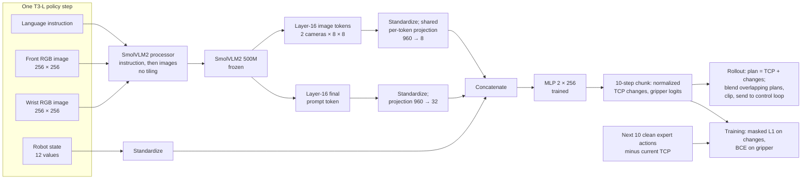

# Frozen-backbone VLA baseline (SmolVLM2)

A language-conditioned pick-and-place policy built on a frozen, pretrained
vision-language model. SmolVLM2-500M encodes the instruction and both camera
images. A 0.39 M-parameter action head, the only trained component, maps those
features and the robot state to a 0.5 s chunk of future actions, which the
policy blends into the shared 5-D action at 20 Hz. The baseline
measures how far frozen VLM features go toward closed-loop control without
fine-tuning the VLM.

Design rationale and supporting measurements are recorded in
[decisions.md](decisions.md#frozen-backbone-vla-baseline). Each training
run's full configuration and metrics are in its `run.json`.

## Summary

| Component | Specification |
| --- | --- |
| Task | T3-L: "Put the {color} cube in the bowl" with 2–3 cubes in the scene |
| Backbone | [`HuggingFaceTB/SmolVLM2-500M-Video-Instruct`](https://huggingface.co/HuggingFaceTB/SmolVLM2-500M-Video-Instruct), frozen, fp16 on MPS, revision pinned in each checkpoint |
| VLM features | Decoder layer 16 at 2 × 64 image tokens (an 8 × 8 grid per camera) and at the final prompt token |
| Trained head | 0.39 M parameters: shared per-token projection 960 → 8, instruction projection 960 → 32, MLP with two 256-unit layers |
| Inputs | Front and wrist RGB at 256 × 256, 12-D robot state, instruction text |
| Output | A chunk of 10 future actions (0.5 s): TCP xyz and yaw changes plus gripper logits. The policy re-plans every 2 steps and blends overlapping chunks into one absolute `[x, y, z, yaw, g]` action per step |
| Training data | Clean expert actions from `t3l-l1`; the limited profile uses 150 episodes and 7,200 frames |
| Compute (M3 Max) | About 33 min to encode the limited profile once (3.8 examples/s, about 3 GB); minutes per head run from cached features |

## Architecture

At each policy step, the instruction and both camera images go through
SmolVLM2 in a single prompt, instruction first. The adapter reads decoder
layer 16 at each camera's 64 image tokens and at the final prompt token. The
head standardizes these features and the robot state, projects every image
token with one shared linear layer, projects the final-token feature
separately, and maps the result through an MLP to a chunk of TCP changes and
gripper logits for the next 10 steps. In training, each change is compared
with the corresponding clean expert action minus the current TCP pose; in
rollout, the changes are added to the TCP pose at prediction time to form a
plan of absolute targets.



### Action chunking

The head predicts the next 10 actions (0.5 s) from each observation. The
policy queries the VLM every `replan_interval` steps (default 2) and stores
each query's plan of absolute targets. At every 20 Hz step it executes the
weighted average of all stored plans that cover that step, where a plan made
`a` steps ago has weight `exp(-ensemble_decay · a)` (default 0, an equal
average); the gripper opens when the averaged open probability is at least
0.5. Chunking makes the policy commit to a short plan instead of deciding
every frame independently, which smooths motion and gripper decisions, and
it runs the VLM half as often. Both settings are inference options
(`--replan-interval`, `--ensemble-decay`) and do not require retraining; the
default was chosen on validation scenes (see
[decisions.md](decisions.md#frozen-backbone-vla-baseline)).

Predicting changes from the TCP pose, as the RL expert does, turns a
prediction error into a drift that the closed loop corrects rather than a
fixed offset. The emitted action follows the shared base-frame TCP target
convention, with yaw in radians and the gripper command in `[0, 1]`.

### VLM adapter

[`FrozenSmolVLMEncoder`](../policies/vla.py#L235) loads the backbone with the
pinned Transformers 5.20.2 `AutoProcessor` and `AutoModelForImageTextToText`
APIs, freezes every parameter, and runs it without gradients. It never
generates text or action tokens. Three choices define its features:

- **No image tiling.** By default, the processor upsamples each 256 px frame
  to 2048 px and splits it into 16 tiles plus a global view, giving 2,279
  tokens per sample. The adapter disables splitting, so each camera is a
  single 512 px view of 64 tokens and a sample has 159 tokens.
- **Instruction first.** The decoder is causal, so image tokens attend only
  to earlier tokens. Placing the instruction before the images makes the
  image-token states depend on which cube was named.
- **Spatial readout.** The adapter keeps every image token's layer-16 state
  as an 8 × 8 grid per camera (front, then wrist), together with the
  layer-16 state of the final prompt token, which summarizes the instruction.

### Action head

[`VLAActionHead`](../policies/vla.py#L407) standardizes the 12-D state, each
camera's token channels, and the final-token feature with statistics computed
from the training frames selected by the profile, never from validation data.
It applies one 960 → 8 linear projection to every image token, preserving the
grid layout in the flattened vector, and a 960 → 32 projection to the
final-token feature. These are concatenated with the normalized state and
passed through two 256-unit GELU layers to 50 outputs: for each of the 10
chunk positions, the change in TCP x, y, z, and yaw from the current pose,
and a gripper logit. Each position's changes are scaled by their own training
mean and standard deviation, because later steps move farther. A positive
logit corresponds to an open gripper.

## Data

### Dataset and labels

Training uses [`data/datasets/t3l-l1`](../data/datasets/t3l-l1/), whose
manifest records 400 accepted expert episodes:

- 380 training and 20 validation episodes, drawn from disjoint seed ranges.
- Each step stores front and wrist 256 × 256 RGB images, the 12-D robot
  state (seven joint positions, gripper width, TCP xyz, and TCP yaw), a clean
  5-D action, the executed 5-D action, and the instruction.
- The demonstrations come from the T3 PPO expert, targeting the cube named in
  the instruction. Collection applies sparse action noise: a 1% event
  probability with 1 cm position and 3° yaw standard deviations.

When a noise event occurs, the environment executes the perturbed
`action.executed`, while the policy is trained on the clean expert `action`.
The demonstrations therefore contain recoveries from small perturbations,
labelled with the expert's intended correction rather than the perturbation.
Object poses are stored in the dataset but are not policy inputs. Validation
episodes use the training instruction templates; held-out templates are
reserved for the instruction-following check.

[`VLAFrameDataset`](../policies/vla.py#L159) adapts each LeRobot row into
images, instruction, state, clean action, and episode index, and validates
their shapes and finiteness.

### Limited red/blue, two-cube profile

`--profile limited` trains on a controlled subset of `t3l-l1`:

- Target colors are red and blue; green-target episodes are excluded. The
  subset still requires the policy to choose between cubes by language.
- Episodes have exactly two active cubes. Inactive cubes sit at fixed staging
  positions and are identified from `observation.environment_state`, which is
  used only for selection; the policy receives images, instruction, and robot
  state.
- Each target color contributes the same number of training episodes, by
  default as many as the smaller color class provides, spread evenly across
  the eligible episodes. Each episode contributes 48 evenly spaced frames.
- Validation uses every matching episode in the validation split, with up to
  48 frames per episode.

On the current dataset this selects 75 episodes per color (150 episodes and
7,200 training frames) and 7 validation episodes (336 frames). With seven
validation episodes, offline validation metrics guide model selection but do
not estimate closed-loop performance. The run record stores the selected
episode IDs and frame indices.

## Training

[`scripts/train_vla.py`](../scripts/train_vla.py) validates the dataset
manifest (`task: T3-L`, training instruction templates), opens both LeRobot
splits, and loads the VLM. [`train_vla`](../policies/vla.py#L732) then:

1. Labels each selected frame with the next 10 clean expert actions from the
   same episode. Positions past the end of the episode repeat its last action
   and are masked out of the loss.
2. Encodes each selected train and validation frame once with the frozen VLM,
   or loads matching features from the feature cache. Token grids are held in
   host memory as fp16, about 1.8 GB for the limited profile. Cached features
   are used only if they reproduce the dataset's current action labels.
3. Computes normalization statistics from the encoded training frames,
   separately for each chunk position.
4. Trains the head with AdamW on a weighted objective over all valid chunk
   positions: 0.8 × L1 on the normalized TCP changes and 0.2 ×
   class-balanced binary cross-entropy on the gripper, with the
   closed-to-open label ratio as the positive weight.
   Dropout (default 0.1) is applied to the projected VLM features, and
   gradients are clipped.
5. Evaluates the head on the cached validation features after every epoch
   and keeps the state with the lowest validation objective.
6. Evaluates the selected head a second time with every VLM feature replaced
   by its training mean. This feature ablation quantifies how much the head
   relies on vision and language rather than robot state alone.
7. Saves the head checkpoint and the run record.

Defaults are a 10-step chunk (`--chunk-size`; 1 trains a single-step head),
batch size 128, learning rate 1e-3, weight decay 1e-2, and up to 60 epochs
with early-stopping patience 10. The `full` profile uses every frame
in both splits. `--max-encoding-samples` and `--max-train-steps` cap a run for
integration checks only: the encoding cap takes the first rows in dataset
order, so capped runs are not representative, and the caps cannot be combined
with the limited profile.

### Running

```sh
uv sync --locked --extra vla
make train-vla VLA_ARGS="t3l-l1 --profile limited --device mps --feature-cache-dir checkpoints/vla/t3l-l1/feature-cache"
```

Runs are written to `checkpoints/vla/t3l-l1/limited-red-blue-two-cube/`, and
reruns are versioned automatically (`-run-02`, `-run-03`, …). The commands in
this document use `RUN_DIR` for the run directory that `make train-vla`
reports, for example:

```sh
RUN_DIR=checkpoints/vla/t3l-l1/limited-red-blue-two-cube-run-06
make tensorboard TENSORBOARD_LOGDIR=$RUN_DIR/tensorboard
```

TensorBoard shows the combined objective, action L1, gripper BCE and
accuracy, per-component MAE, gradient norm, learning rate, throughput, and
the chunk and feature-ablation L1 of the selected head.

`--resume-from` continues a run in place with a fresh optimizer, and
`--initialize-from` starts a new versioned run from an existing head. Both
require the same dataset version, profile, frame selection, model revision,
and feature layer.

### Feature cache

Encoding dominates training time. With `--feature-cache-dir DIR`, each split's
encoded features are stored under `DIR`, keyed by dataset ID and version,
selected frame indices, model ID and revision, Transformers version, model
dtype, feature layer, prompt layout, and encoding cap. A run with a matching
key loads the features instead of running the VLM, so head-only changes such
as learning rate, dropout, or epochs take minutes. `run.json` records how many
examples came from the cache and the original encoding time. The cache can be
deleted at any time and is regenerated on demand.

## Evaluation

### Offline metrics

The head is evaluated before training and after every epoch. Validation
action L1 is the mean absolute error of the first action in the chunk, the
one that would execute immediately, after the predicted change is added to
the TCP pose, across the four continuous components and the binary gripper
decision; it is directly comparable with single-step heads.
`validation_chunk_l1` averages the same error over every valid chunk
position. The run record also stores per-component MAE, gripper accuracy,
per-episode error, and the first-step metrics with the VLM features ablated (`ablated_validation_l1`,
`ablated_validation_action_mae`). A small gap between the two indicates that
the head is not using vision or language.

Offline error is a weak proxy for closed-loop success. The L1 mixes metres,
radians, and a unitless gripper decision. A state-only MLP already reaches
about 2–3 mm per-axis error, because after about one second the TCP trajectory
itself reveals the expert's target. Neither metric measures task completion
or grounding.

### Closed-loop evaluation

- [`scripts/smoke_vla.py`](../scripts/smoke_vla.py) runs two T3-L episodes
  with different named colors on validation seeds, using a held-out
  instruction template. It reports each episode's success, whether a
  non-target cube moved more than 2 cm, and p50/p95 action latency after
  warm-up. For limited-profile checkpoints (the default follows the
  checkpoint), it restricts scenes to red/blue targets with two active cubes.
- [`scripts/evaluate_vla.py`](../scripts/evaluate_vla.py) runs the shared
  evaluation harness on image observations. By default it evaluates 50
  episodes from the full T3-L distribution on evaluation seeds starting at
  1,000,000 and reports success rate, Wilson 95% interval, and failure
  breakdown. Full-profile results are written to
  `eval/results/vla-prototype/`, and limited-profile checkpoints to
  `eval/results/vla-prototype-limited/`; chunked heads append their chunk,
  re-planning, and decay settings to the method name. The wrong-object rate
  is not yet computed by this evaluator.

All three scripts, and the viewer, accept `--replan-interval` and
`--ensemble-decay` for chunked heads.

`--scope limited` evaluates only red/blue targets with two active cubes, using
the training instruction templates. It scans evaluation seeds until it has
the requested number of matching episodes and saves each episode's robot
state, action, next state, object positions, and outcome at every step (no
camera frames). Each trajectory also records the chunk size, re-planning
interval, and ensemble decay, which are part of the result's configuration
hash. A single-step head takes about 80 s per 15 s episode on the reference
laptop; re-planning every 2 steps halves the VLM time.

```sh
make evaluate-vla VLA_EVAL_ARGS="--checkpoint $RUN_DIR/checkpoint.pt --scope limited --episodes 20 --seed-start 1000000 --max-candidates 1000 --device mps --results-dir eval/results/vla-limited-chunk"
```

Results are written to
`eval/results/vla-limited-chunk/vla-prototype-limited-matched/T3-L-L1.json`,
with per-episode trajectories in `T3-L-L1-trajectories/` beside it. A
separate `--results-dir` keeps these runs out of the generated benchmark
report. Limited-scope runs are diagnostics; reportable success rates follow
the roadmap's evaluation rules (§5), including at least 50 episodes for image
policies.

### Replay

A saved trajectory can be rendered to a real-time 20 Hz GIF without running
the VLA:

```sh
make render-vla-trajectory VLA_RENDER_ARGS="--trajectory eval/results/vla-limited-chunk/vla-prototype-limited-matched/T3-L-L1-trajectories/seed-1000011.json --gif docs/media/t3l-l1-vla-chunk.gif"
```

The replay resets the scene from the saved seed and instruction template,
applies the recorded actions, and verifies every resulting state against the
trajectory before writing the GIF. `--gif-fps`, `--gif-width`, `--gif-height`,
and `--show-tcp` control the output.

## Inference and checkpoints

[`VLAActionPolicy`](../policies/vla.py#L560) implements the shared `Policy`
interface. It receives the instruction at `reset`, which also discards stored
plans, lazily loads the frozen VLM at the checkpoint's revision and feature
layer, and returns one clipped 5-D action per call, querying the VLM every
`replan_interval` calls. View a seeded rollout in the MuJoCo viewer with:

```sh
make view-vla VLA_VIEW_ARGS="--checkpoint $RUN_DIR/checkpoint.pt --seed 1000000 --device mps"
```

The checkpoint (format 4) stores the head weights, all normalization
statistics, the VLM identifier and immutable revision, the training profile,
the feature layer, the image-token count, and the chunk size; it does not
duplicate the VLM weights. Format-3 single-step checkpoints load with a chunk
size of 1, and earlier formats are rejected. Each run's `run.json` records the
configuration, dataset version, selected seeds and frames, hardware,
precision, VLM revision, encoding throughput and memory, cached-example
count, validation, chunk, and feature-ablation metrics, and run status.

## Limitations

- **Grasp completion.** Action chunking largely removed the single-step
  head's gripper flicker, and the arm now commits to a cube in almost every
  episode, but many grasps still fail: the gripper closes slightly off the
  cube, or the arm pushes the other cube while approaching. The PPO expert
  grasps while moving and releases above the bowl, which leaves little
  margin for position errors.
- **No failure recovery in the data.** The datasets keep only successful
  expert episodes, so states after a missed grasp are out of distribution.
- **Limited scene diversity.** The limited profile contains 150 training
  scenes; training error is substantially lower than validation error.

## Future work

The extensions below are not planned. They record the directions that the
current results suggest would most improve this baseline.

### Evaluation

- **Larger evaluation.** Evaluate at least 50 episodes per cell, the minimum
  for a reportable image-policy result in this project, and generate the
  tables with `eval/report.py`. The 20-episode limited-scope runs are
  diagnostics.
- **Wrong-object rate.** Compute it in the evaluator: a cube other than the
  named one moved more than 2 cm or ended in the bowl. The smoke test reports
  it per episode, and limited-scope trajectories contain the data needed to
  compute it, but the evaluator does not aggregate it yet.
- **Language generalization.** Evaluate the held-out instruction template
  ("Move the {color} cube into the bowl.") beyond the two-episode smoke test.
- **Full task distribution.** Evaluate green targets and three-cube scenes,
  which requires a head trained on the full profile.
- **Latency.** Record p50 and p95 action latency at the default re-planning
  interval, alongside the VLM query latency.

### Data

- **Recovery data with DAgger.** Run the trained policy in simulation, label
  the states it visits with the PPO expert, which observes the true object
  poses, and retrain on the aggregated data. This directly targets states
  after a missed grasp, which the success-only demonstrations never contain.
  The expert integrates its actions into an internal target, so labelling
  arbitrary states needs that target initialized consistently. A cheaper
  alternative is collecting demonstrations with larger or more frequent
  action perturbations.
- **More scenes.** Train on the full profile: all 380 training episodes,
  including green targets and three-cube scenes, about 50,000 frames. It
  takes about 3.7 hours to encode once and a 12 GB feature cache. Collect
  more validation episodes as well, since seven is too few for reliable
  model selection.

### Model and training

- **Closed-loop model selection.** Keep several candidate checkpoints and
  select by success on validation seeds instead of offline validation loss,
  which is dominated by frames where the robot state alone predicts the
  action.
- **Regularization sweep.** Sweep dropout, weight decay, Gaussian noise on
  the VLM features, and random masking of the robot-state input. The feature
  cache makes each run take minutes. Image augmentation would require
  caching several augmented encodings of each frame.
- **Instruction-conditioned spatial pooling.** Replace the flattened
  per-token projection with attention pooling, using the instruction feature
  as the query over the 8 × 8 token grids, so cube appearance is learned
  independently of its position and the instruction selects the target
  directly. A spatial-softmax variant underperformed the current head in
  probes on cached features, so new heads should be screened the same way
  before full training.
- **Feature layer.** Compare other decoder layers, or a concatenation of two,
  for the image-token grid; only layers 0, 16, and 32 were compared for it.
- **Chunk settings.** Tune the chunk length and the ensemble decay, which
  were fixed at 10 steps and 0 (equal weighting). Only the re-planning
  interval was tuned.

### Inference

- **Truncated decoder.** Only layer 16 is read, so the remaining 16 decoder
  layers can be skipped without changing the features. The vision encoder,
  which processes 2 × 1,024 patches per query, probably dominates the cost,
  so profile before optimizing further.
